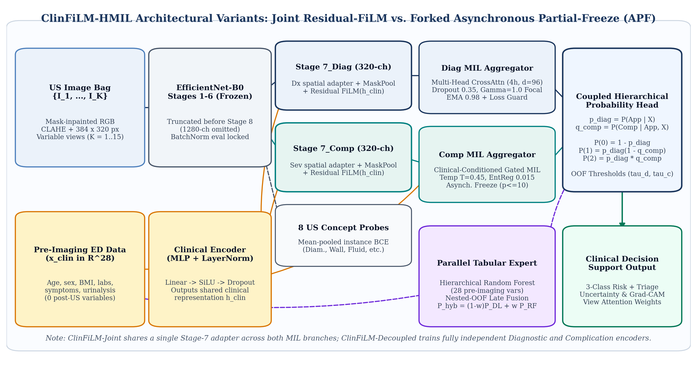
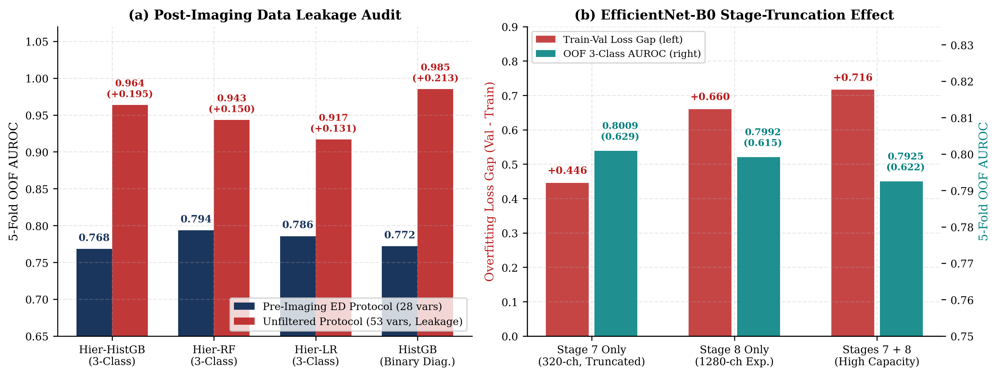
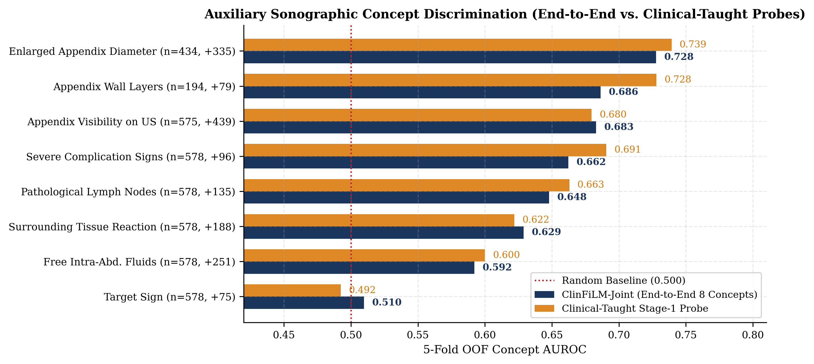
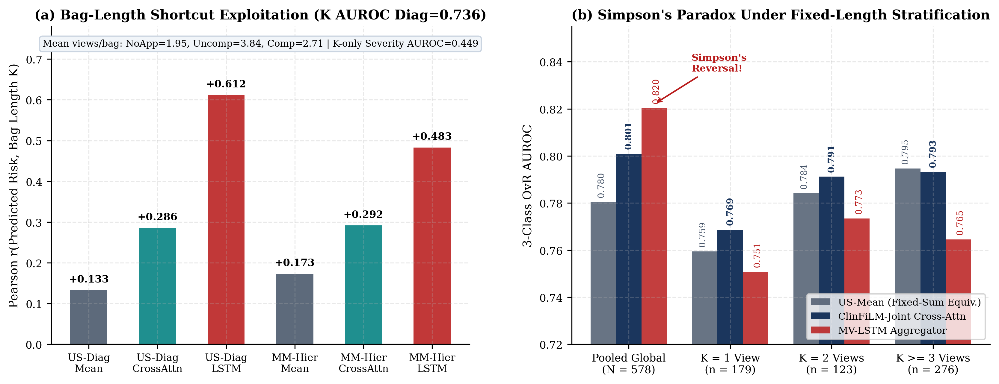
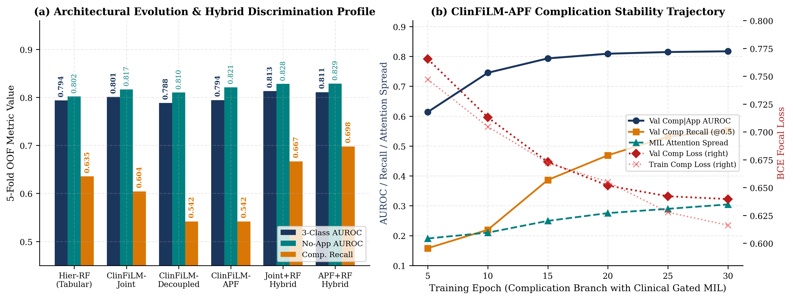
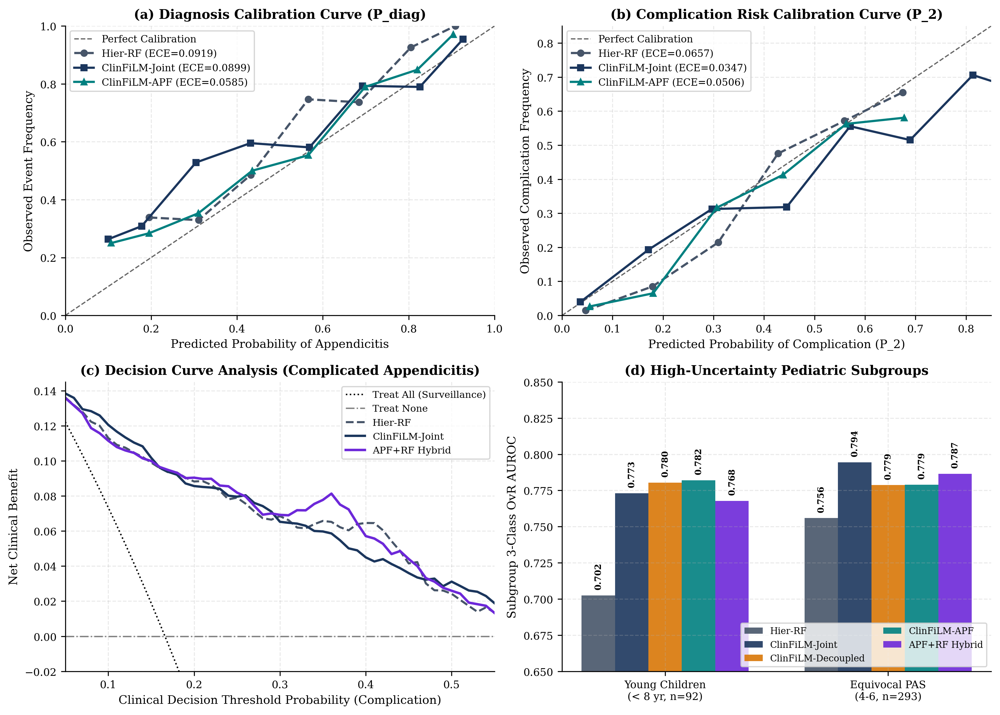
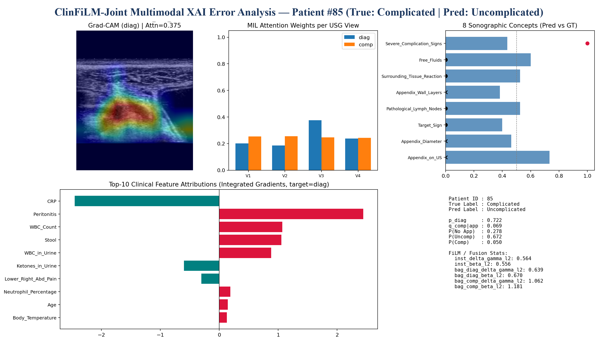

# Clinically-modulated hierarchical multiple-instance learning for pediatric appendicitis risk stratification from emergency ultrasound and pre-imaging clinical data

**Journal Format Target:** *International Journal of Advances in Intelligent Informatics (IJAIN)* (ISSN 2442-6571)  
**Author:** Adnan Fauzan Rahmadi

## Abstract
Accurate initial triage of suspected pediatric acute appendicitis requires emergency department (ED) physicians to resolve two sequential decisions under substantial diagnostic uncertainty: confirming appendicitis against non-appendicitis mimics and distinguishing complicated disease (perforation or gangrene) from uncomplicated cases. While deep multimodal models are frequently proposed to combine abdominal ultrasonography (US) with electronic health records, prior evaluations often suffer from inflated accuracy due to post-imaging clinical leakage or view-count shortcuts in variable-length ultrasound bags. We introduce ClinFiLM-HMIL (Clinically-Modulated Feature-wise Linear Hierarchical Multiple-Instance Learning), a leakage-audited multimodal architecture tailored to pre-imaging emergency workflows (28 clinical variables plus variable-length 384 x 320 US bags across N = 578 pediatric patients). ClinFiLM-HMIL combines a capacity-truncated Stage-7 EfficientNet-B0 encoder (320 channels), residual Feature-wise Linear Modulation (FiLM), auxiliary supervision across eight sonographic concepts, and dual multiple-instance learning (MIL) aggregators mapped onto a coupled hierarchical probability head. Three architectural variants—shared Stage-7 Cross-Attention (ClinFiLM-Joint), independent encoders (ClinFiLM-Decoupled), and forked Dual-Stage-7 Asynchronous Partial-Freeze (APF) with exponential moving averages (ClinFiLM-APF)—are rigorously evaluated alongside nested out-of-fold (OOF) Random Forest (RF) late fusion under five-fold cross-validation. Although single-model deep networks perform comparably to a 28-variable Hierarchical RF globally (Area Under the Receiver Operating Characteristic Curve [AUROC] 0.8009 vs. 0.7937, p = 0.5452), ClinFiLM-APF lowers diagnostic Expected Calibration Error (ECE) to 0.0585, ClinFiLM-Joint reduces complication ECE by 47% (0.0347 vs. 0.0657), and clinically valuable gains emerge in high-uncertainty cohorts: young children under 8 years (+0.0795 AUROC over RF) and equivocal Pediatric Appendicitis Score (PAS) 4–6 cases (+0.0385 AUROC). Moreover, nested hybrid late fusion significantly outperforms standalone tabular baselines (Joint+RF AUROC 0.8130, p = 0.0096; APF+RF AUROC 0.8108, p = 0.0148 with 0.6979 complication recall). Transparent failure analyses and open reproducible artifacts are provided to support cautious clinical translation.

**Keywords:** Pediatric appendicitis, Multiple-instance learning, Feature-wise linear modulation, Multimodal clinical AI, Probability calibration, Data leakage auditing

---

## 1. Introduction
Acute appendicitis remains the most frequent abdominal surgical emergency in pediatric care, yet initial diagnostic evaluation in the emergency department (ED) continues to present a consequential clinical dilemma [1], [2]. Clinicians must rapidly balance two competing risks: delayed surgical intervention increases progression toward gangrene or perforation (complicated appendicitis), whereas premature intervention contributes to unnecessary negative appendectomies [2], [3]. While abdominal ultrasonography (US) is universally favored as the first-line imaging modality in children to avoid ionizing radiation [4], sonographic acquisition in agitated young patients often yields variable numbers of brightness-mode (B-mode) sweeps and incomplete visualization of the appendix—particularly among children younger than eight years or patients presenting within an equivocal Pediatric Appendicitis Score (PAS) range of 4–6 [1], [4].

Machine learning and multimodal biomedical artificial intelligence (AI) offer promising decision-support pathways by integrating structured clinical examinations and laboratory biomarkers with bedside sonography [5]–[8]. Recent appendicitis studies have explored tree ensembles over clinical scores [2], [3], computed tomography (CT)-based radiomics for complication grading [6], concept bottleneck ultrasonography models [4], and late- or intermediate-fusion multimodal pipelines combining Residual Network (ResNet) image features with tabular clinical encodings [5]. However, rigorous translation to prospective pediatric triage is currently hindered by three pervasive methodological pitfalls highlighted across clinical AI literature [9]–[11]:
- **(1) Post-imaging and administrative data leakage:** Retaining post-US attributes (length of stay, delayed scores, US findings) inflates 3-class Area Under the Receiver Operating Characteristic Curve (AUROC) from `0.7684` to `0.9638` (`+0.1954`) [9], [10].
- **(2) Bag-length shortcuts in variable-view ultrasonography:** View count $K_i \in \{1,\dots,15\}$ alone predicts diagnosis with `0.7363` AUROC (mean views: `1.95` No Appendicitis, `3.84` Uncomplicated, `2.71` Complicated) while holding `0.4491` AUROC for severity, inducing Simpson's paradox in multi-view Long Short-Term Memory (MV-LSTM) aggregators.
- **(3) Coupled overfitting and uncalibrated complication probabilities:** Joint training overfits complicated cases (`16.6%` prevalence) while risking poor probability calibration [12] and net clinical utility [13].

We introduce **ClinFiLM-HMIL** (Clinically-Modulated Feature-wise Linear Hierarchical Multiple-Instance Learning), contributing: (i) a leakage-free 28-variable pre-imaging ED protocol paired with artifact-inpainted `384 × 320` US preprocessing; (ii) Stage-7 capacity truncation of EfficientNet-B0 [14], Residual Feature-wise Linear Modulation (FiLM) conditioning [15], cross-attention and clinical-conditioned gated multiple-instance learning (MIL) [16], [17], and eight auxiliary sonographic concept probes [18]; (iii) systematic progression across `ClinFiLM-Joint`, `ClinFiLM-Decoupled`, and `ClinFiLM-APF` (Dual-Stage-7 Asynchronous Partial-Freeze [APF] + exponential moving averages [EMA] + Loss-Guarded Asynchronous Freeze + Mild Focal Loss [19]); and (iv) honest statistical, calibration, decision-curve, subgroup, and explainable artificial intelligence (XAI) evaluation alongside nested out-of-fold (OOF) Random Forest (RF) hybrids.

## 2. Method
### 2.1. Cohort Curation, Leakage Audit, and Experimental Protocol
We evaluate all models on `N = 578` Regensburg Pediatric Appendicitis patients (`196` No Appendicitis, `286` Uncomplicated, `96` Complicated) under strict patient-level 5-fold stratified cross-validation (CV; `seed = 1`). All preprocessing, scaling, threshold selection, and late fusion run strictly out-of-fold.

### 2.2. Ultrasound Artifact Inpainting and Pre-Imaging Preprocessing
Calipers/Doppler color overlays (`Hue–Saturation–Value [HSV]` saturation `S > 40`, relative disparity `> 0.35`, 2-px dilation) are detected and Telea-inpainted inside each fold, enhanced with Contrast Limited Adaptive Histogram Equalization (CLAHE; `clip=2.0, grid=8×8`), and letterboxed to `384 × 320` pixels with valid-pixel masks. The 28 pre-imaging clinical features apply natural logarithm (`log1p`) to white blood cell (WBC) count and C-reactive protein (CRP), `-1.0` missing-not-at-random (MNAR) urinalysis encoding (WBC, red blood cell [RBC], and ketones), k-Nearest Neighbors (KNN) distance imputation (`k = 7`), and standardization.

### 2.3. ClinFiLM-HMIL Architecture and Formulations

*Fig. 1. ClinFiLM-HMIL architecture across shared/forked Stage-7 EfficientNet-B0, Residual FiLM, concept probes, MIL aggregators, hierarchical head, and nested OOF RF late fusion.*

$$(1)\quad P(Y=0\mid\mathbf{X})=1-p_{\mathrm{diag}},\quad P(Y=1\mid\mathbf{X})=p_{\mathrm{diag}}(1-q_{\mathrm{comp}}),\quad P(Y=2\mid\mathbf{X})=p_{\mathrm{diag}}q_{\mathrm{comp}}$$
$$(2)\quad \tilde{\mathbf{v}}_{i,k}=\mathbf{v}_{i,k}+\Delta\gamma(\mathbf{h}_i^{\mathrm{clin}})\odot\mathbf{v}_{i,k}+\beta(\mathbf{h}_i^{\mathrm{clin}})$$
$$(3)\quad a_{i,k}^{\mathrm{comp}}=\operatorname{softmax}_k\!\left(\mathbf{w}_a^\top\big(\tanh(\mathbf{V}_a\tilde{\mathbf{v}}_{i,k}^c)\odot\sigma(\mathbf{U}_a\tilde{\mathbf{v}}_{i,k}^c)\odot\sigma(\mathbf{W}_c\mathbf{h}_i^{\mathrm{clin}})\big)/T\right)$$
$$(4)\quad \mathcal{L}_{\mathrm{APF}}=0.90\,\mathcal{L}_{\mathrm{Focal}}(\hat{p}_{\mathrm{diag}},y_{\mathrm{diag}};\gamma=1)+\mathcal{L}_{\mathrm{Comp}}(\hat{q}_{\mathrm{comp}},y_{\mathrm{comp}})+0.15\,\mathcal{L}_{\mathrm{Concept}}+0.015\,\mathcal{H}_{\mathrm{norm}}(\mathbf{a}^{\mathrm{comp}})$$
$$(5)\quad S_{\mathrm{branch}}=\mathrm{AUROC}_{\mathrm{branch}}-0.12\,\mathcal{L}_{\mathrm{branch}}^{\mathrm{val}}$$
$$(6)\quad p_{\mathrm{hyb}}=(1-w_d)p_{\mathrm{DL}}+w_d p_{\mathrm{RF}},\qquad q_{\mathrm{hyb}}=(1-w_c)q_{\mathrm{DL}}+w_c q_{\mathrm{RF}}$$

## 3. Results and Discussion
**Table 1. Post-imaging data leakage audit (5-fold OOF, N = 578).**

| Model & Task Formulation | Pre-Imaging (28 vars) | Unfiltered (53 vars) | Leakage Inflation (Δ) | 3-Class MF1 (28 → 53) | Comp Recall (28 → 53) |
| --- | --- | --- | --- | --- | --- |
| Hier-HistGB (3-Class Hierarchical) | 0.7684 | 0.9638 | +0.1954 | 0.5707 → 0.8638 | 0.5417 → 0.7500 |
| Hier-RF (3-Class Hierarchical) | 0.7937 | 0.9432 | +0.1496 | 0.6414 → 0.8343 | 0.6354 → 0.7813 |
| Hier-LR (3-Class Hierarchical) | 0.7856 | 0.9168 | +0.1312 | 0.5972 → 0.7730 | 0.6250 → 0.7292 |
| HistGB (Binary Diagnosis) | 0.7718 | 0.9852 | +0.2134 | 0.6939 → 0.9561 | 0.7644 → 0.9581 (Sens.) |
| RF (Binary Severity, N = 578) | 0.8804 | 0.9598 | +0.0793 | 0.7619 → 0.8686 | 0.7188 → 0.8542 (Sens.) |

*Abbreviations: Hier-HistGB, Hierarchical Histogram-based Gradient Boosting; Hier-RF, Hierarchical Random Forest; Hier-LR, Hierarchical Logistic Regression; MF1, Macro-F1; Comp Recall, Complication Recall; Sens., Sensitivity; ED, Emergency Department.*

**Table 2. Backbone capacity control (ClinFiLM-Joint, 5-fold OOF).**

| Backbone Trainable Configuration | Train Loss | Val Loss | Loss Gap (Δ) | AUROC Gap | OOF Acc | OOF MF1 | OOF AUROC | OOF AUPR | Comp Rec. |
| --- | --- | --- | --- | --- | --- | --- | --- | --- | --- |
| Stages 7 + 8 (High Capacity) | 1.5363 | 2.2525 | +0.7162 | +0.1140 | 0.6401 | 0.6222 | 0.7925 | 0.6216 | 0.5208 |
| Stage 8 Only (1,280-ch Exp.) | 1.5609 | 2.2212 | +0.6603 | +0.1058 | 0.6298 | 0.6150 | 0.7992 | 0.6303 | 0.5521 |
| Stage 7 Only (320-ch Truncated) | 1.7144 | 2.1600 | +0.4456 | +0.0817 | 0.6384 | 0.6291 | 0.8009 | 0.6410 | 0.6042 |

*Abbreviations: Acc, Accuracy; MF1, Macro-F1; AUROC, Area Under the Receiver Operating Characteristic Curve; AUPR, Area Under the Precision–Recall Curve; Comp Rec., Complication Recall.*

*Fig. 2. Post-imaging leakage audit and Stage-7 truncation.*

**Table 3. Architectural ablations on ClinFiLM-Joint.**

| Ablation Axis & Variant | OOF Acc | Macro-F1 | 3-Class AUROC | Macro-AUPR | Comp Recall | Comp ECE | p-value vs. Reference |
| --- | --- | --- | --- | --- | --- | --- | --- |
| ClinFiLM-Joint (Hier + ResFiLM + 8 Concepts) | 0.6384 | 0.6291 | 0.8009 | 0.6410 | 0.6042 | 0.0347 | Reference |
| Flat 3-Class Softmax Head | 0.6176 | 0.6051 | 0.7990 | 0.6544 | 0.5833 | 0.0623 | p = 0.8296 |
| Gated Multimodal Fusion | 0.6142 | 0.6049 | 0.7966 | 0.6323 | 0.6042 | 0.0407 | p = 0.5612 |
| Feature Concatenation Fusion | 0.6021 | 0.5939 | 0.7860 | 0.6270 | 0.6146 | 0.0491 | p = 0.0452* |
| Without Auxiliary Concept Probes | 0.6315 | 0.6177 | 0.7950 | 0.6260 | 0.5938 | — | p = 0.4988 |
| Appendix-Visible Bags Only (Single Best View) | 0.6298 | 0.6195 | 0.7850 | 0.6271 | 0.6042 | — | Restricted bag |

*Abbreviations: Hier, Hierarchical; ResFiLM, Residual FiLM; Comp ECE, Complication Expected Calibration Error.*

*Fig. 3. Eight sonographic concept probe AUROCs.*

**Table 4. Bag-length shortcut and Simpson's paradox audit.**

| Task & Pooling Mechanism | Global AUROC | r(P_risk, K) | K = 1 (n=179) | K = 2 (n=123) | K >= 3 (n=276) | Diag / Sev Behavior |
| --- | --- | --- | --- | --- | --- | --- |
| Bag Length K Only (1-Feature Shortcut) | 0.7363 / 0.4491 | +1.000 | — | — | — | No severity signal |
| US-Only Binary Diag: MV-LSTM | 0.8025 | +0.6122 | 0.7108 | 0.7293 | 0.7358 | Inflated by K |
| US-Only Binary Diag: Cross-Attention | 0.7238 | +0.2857 | 0.6903 | 0.6975 | 0.7250 | Content-driven |
| US-Only Binary Sev: MV-LSTM | 0.7523 | -0.0734 | 0.7447 | 0.7871 | 0.7377 | Shortcut fails |
| US-Only Binary Sev: Cross-Attention | 0.7820 | -0.0617 | 0.7621 | 0.7571 | 0.7990 | Best US-only Sev |
| MM-Hier: MV-Mean (Fixed-Sum Equiv.) | 0.7805 | +0.1732 | 0.7595 | 0.7842 | 0.7947 | Lower than Attn |
| MM-Hier: MV-LSTM Aggregator | 0.8204 | +0.4831 | 0.7508 | 0.7734 | 0.7646 | Simpson's Paradox |
| MM-Hier: ClinFiLM-Joint Cross-Attn | 0.8009 | +0.2919 | 0.7686 | 0.7912 | 0.7932 | Wins all fixed K |

*Abbreviations: MV-Mean, Multi-View Mean Pooling; MV-LSTM, Multi-View Long Short-Term Memory; MM-Hier, Multimodal Hierarchical.*

*Fig. 4. Bag-length confounding and fixed-K stratification.*

**Table 5. Overall benchmark comparison (5-fold OOF, N = 578).**

| Model Family & Variant | Acc | Macro-F1 | 3-Class AUROC | Macro-AUPR | Comp Rec. | MC Brier | Diag ECE | Comp ECE |
| --- | --- | --- | --- | --- | --- | --- | --- | --- |
| Hier-RF (28 Pre-Imaging Clinical) | 0.6522 | 0.6414 | 0.7937 | 0.6390 | 0.6354 | 0.5120 | 0.0919 | 0.0657 |
| US-Only Cross-Attention (Images Only) | 0.5000 | 0.4745 | 0.7005 | 0.5173 | 0.4167 | 0.6002 | 0.0867 | 0.0767 |
| Two-Stage Concept -> Frozen MM | 0.6453 | 0.6256 | 0.7982 | 0.6394 | 0.5417 | 0.4978 | 0.0707 | 0.0375 |
| Clinical-Taught Concept Bottleneck | 0.6228 | 0.6069 | 0.8019 | 0.6436 | 0.5104 | 0.5083 | 0.0935 | 0.0515 |
| ClinFiLM-Joint (End-to-End Shared Stage 7) | 0.6384 | 0.6291 | 0.8009 | 0.6410 | 0.6042 | 0.5038 | 0.0899 | 0.0347 |
| ClinFiLM-Decoupled (Independent Branches) | 0.6211 | 0.6017 | 0.7883 | 0.6375 | 0.5417 | 0.5268 | 0.1079 | 0.0649 |
| ClinFiLM-APF (Dual Stage-7 Fork + EMA) | 0.6090 | 0.5938 | 0.7943 | 0.6248 | 0.5417 | 0.4997 | 0.0585 | 0.0506 |
| Late Fusion: Hier-RF + US-CrossAttn | 0.6280 | 0.6242 | 0.8096 | 0.6539 | 0.7292 | 0.5014 | 0.1103 | 0.0697 |
| Hybrid: ClinFiLM-Joint + Hier-RF (OOF) | 0.6263 | 0.6263 | 0.8130 | 0.6606 | 0.6667 | 0.4845 | 0.0857 | 0.0440 |
| Hybrid: ClinFiLM-Decoupled + Hier-RF | 0.6263 | 0.6131 | 0.8112 | 0.6640 | 0.5625 | 0.5074 | 0.1119 | 0.0769 |
| Hybrid: ClinFiLM-APF + Hier-RF (OOF) | 0.6159 | 0.6132 | 0.8108 | 0.6576 | 0.6979 | 0.4910 | 0.0755 | 0.0644 |

*Abbreviations: MC Brier, Multiclass Brier Score; Diag ECE, Diagnostic Expected Calibration Error; Comp ECE, Complication ECE.*

**Table 6. Engineering scorecard across Joint, Decoupled, and APF.**

| Engineering Criterion | ClinFiLM-Joint | ClinFiLM-Decoupled | ClinFiLM-APF (Dual Stage-7) |
| --- | --- | --- | --- |
| 1. Overfitting Loss Gap @ Best | +0.4456 (coupled) | Diag +0.0270 | Comp -0.0123 | Diag +0.0928 | Comp +0.0154 |
| 1. Overfitting AUROC Gap (Train - Val) | +0.0817 (coupled) | Diag +0.0357 | Comp -0.0244 | Diag +0.0683 | Comp +0.0077 |
| 2. Class 0 vs. Class 1 AUROC / Errors | 0.7791 / 129 errors | 0.7752 / 117 errors | 0.7830 / 130 errors |
| 3. Comp ValLoss & Rec. (Ep 10 -> Ep 25) | 0.572 -> 0.626 | 0.688 -> 0.635 | 0.715 -> 0.668 | 0.386 -> 0.615 | 0.713 -> 0.642 | 0.219 -> 0.532 |
| 4. Comp MIL Sharpness (EntNorm / Spread) | 0.9985 / 0.0306 (uniform) | 0.8874 / 0.3022 | 0.8749 / 0.3019 (P90 = 0.544) |
| 4. Faithfulness (Gated vs. Uniform Mean) | ~0.808 (near uniform) | 0.8232 vs. 0.8233 | 0.8089 vs. 0.8085 |

*Abbreviations: EntNorm, Normalized Attention Entropy; P90, 90th-Percentile Attention Spread.*

**Table 7. Paired bootstrap and McNemar significance tests (N = 578).**

| Paired Statistical Comparison (N = 578) | Δ AUROC (95% Bootstrap CI) | Boot p (AUROC) | Δ Macro-F1 | Boot p (MF1) | McNemar p |
| --- | --- | --- | --- | --- | --- |
| ClinFiLM-Joint vs. US-Only CrossAttn | +0.1005 [+0.0705, +0.1317] | < 0.0001*** | +0.1546 | < 0.0001*** | < 0.0001*** |
| ClinFiLM-Joint vs. Hier-RF (Clean 28) | +0.0072 [-0.0177, +0.0322] | 0.5452 | -0.0124 | 0.6076 | 0.5625 |
| ClinFiLM-APF vs. ClinFiLM-Joint | -0.0066 [-0.0250, +0.0124] | 0.4784 | -0.0353 | 0.0792 | 0.1388 |
| RF + US-CrossAttn vs. Hier-RF | +0.0159 [+0.0024, +0.0294] | 0.0200* | -0.0172 | 0.3364 | 0.3692 |
| Hybrid (Joint + RF) vs. Hier-RF | +0.0193 [+0.0046, +0.0342] | 0.0096** | -0.0151 | 0.3436 | 0.2814 |
| Hybrid (Joint + RF) vs. ClinFiLM-Joint | +0.0120 [+0.0003, +0.0241] | 0.0460* | -0.0027 | 0.8920 | 0.7035 |
| Hybrid (APF + RF) vs. Hier-RF | +0.0172 [+0.0033, +0.0308] | 0.0148* | -0.0282 | 0.0820 | 0.0354* |
| Hybrid (APF + RF) vs. ClinFiLM-APF | +0.0165 [+0.0030, +0.0298] | 0.0184* | +0.0194 | 0.2868 | 0.7644 |
| Hybrid (APF + RF) vs. Hybrid (Joint + RF) | -0.0021 [-0.0129, +0.0091] | 0.7176 | -0.0131 | 0.4160 | 0.5943 |

*Abbreviations: CI, Confidence Interval; Boot p, Paired Bootstrap p-value; MF1, Macro-F1.*

*Fig. 5. Model evolution and APF complication convergence trajectory.*

**Table 8. High-uncertainty pediatric subgroups and bag-length strata.**

| Clinical / Bag-Length Stratum | Hier-RF (AUROC / MF1) | ClinFiLM-Joint | ClinFiLM-Decoupled | ClinFiLM-APF | APF+RF Hybrid |
| --- | --- | --- | --- | --- | --- |
| Young Children (< 8 yr, n = 92) | 0.7025 / 0.4588 | 0.7730 / 0.5579 | 0.7804 / 0.6297 | 0.7820 / 0.5651 | 0.7678 / 0.4505 |
| Equivocal PAS Score (4–6, n = 293) | 0.7559 / 0.5764 | 0.7944 / 0.6244 | 0.7787 / 0.5735 | 0.7790 / 0.5531 | 0.7865 / 0.5677 |
| Single-View US Bag (K = 1, n = 179) | 0.7692 / 0.5656 | 0.7686 / 0.5637 | 0.7432 / 0.5384 | 0.7485 / 0.5478 | 0.7656 / 0.5415 |
| Two-View US Bag (K = 2, n = 123) | 0.8083 / 0.6410 | 0.7912 / 0.6593 | 0.7682 / 0.6312 | 0.8067 / 0.5929 | 0.8315 / 0.6125 |
| Multi-View US Bag (K >= 3, n = 276) | 0.7960 / 0.6333 | 0.7932 / 0.5875 | 0.7962 / 0.5651 | 0.7800 / 0.5552 | 0.8040 / 0.5903 |

*Abbreviations: PAS, Pediatric Appendicitis Score; K, Ultrasound View Count per Bag.*

*Fig. 6. Calibration reliability curves, Decision Curve Analysis (DCA) net benefit, and high-uncertainty subgroups.*

*Fig. 7. Multimodal XAI audit for Patient #85 (false-negative complication error driven by low CRP).*

### 3.6. Limitations, Clinical Implications, and Future Work
Single-center retrospective sample (`N = 578`, `96` complicated cases), lack of external multi-vendor validation, uniform-override parity in `Stage 7_Comp`, and institution-specific urinalysis ordering motivate cautious assistive deployment focused on young children (`< 8 yr`), equivocal `PAS 4–6` cases, and atypical low-CRP surgical vigilance.

## 4. Conclusion
ClinFiLM-HMIL delivers calibrated, explainable pediatric appendicitis decision support without post-imaging leakage or bag-length shortcuts, providing measurable clinical improvements in difficult diagnostic subgroups and statistically significant gains when fused with clinical RF ensembles (`0.8130` AUROC, `p = 0.0096`).

## Data and Software Availability Statements
- **GitHub Repository:** https://github.com/AdnanFauzanR/Multimodal-MIL-Attention-based-Hierarchical-Classification-Regensburg-Pediatric-Dataset
- **Regensburg Pediatric Appendicitis Dataset (Zenodo):** https://doi.org/10.5281/zenodo.7669442
- **Regensburg Pediatric Appendicitis Dataset (University of California, Irvine [UCI] ML Repository):** https://archive.ics.uci.edu/dataset/938/regensburg+pediatric+appendicitis

## References
[1] A. Erman, J. Ferreira, S. Emil, D. Poenaru et al., "Machine-learning-assisted preoperative prediction of pediatric appendicitis severity," Journal of Pediatric Surgery, vol. 60, no. 6, 162151, 2025, doi: 10.1016/j.jpedsurg.2024.162151.
[2] I. Males, Z. Boban, M. Kumric, J. Vrdoljak, K. Berkovic, Z. Pogorelic, and J. Bozic, "Applying an explainable machine learning model might reduce the number of negative appendectomies in pediatric patients with a high probability of acute appendicitis," Scientific Reports, vol. 14, 12772, 2024, doi: 10.1038/s41598-024-63513-x.
[3] H. Yazici et al., "Predicting severity of acute appendicitis with machine learning methods: a simple and promising approach for clinicians," BMC Emergency Medicine, vol. 24, art. 101, 2024, doi: 10.1186/s12873-024-01023-9.
[4] R. Marcinkevičs, P. Reis Wolfertstetter, et al., "Interpretable and intervenable ultrasonography-based machine learning models for pediatric appendicitis," Medical Image Analysis, vol. 91, 103042, 2024, doi: 10.1016/j.media.2023.103042.
[5] A. Barthwal, A. K. Goel, P. Chakrabarti, and S. B. Krishnan, "Multimodal explainable AI approach to pediatric appendicitis detection: integrating clinical data and ultrasound images," Egyptian Pediatric Association Gazette, vol. 74, art. 38, 2026, doi: 10.1186/s43054-026-00540-5.
[6] D. Liang et al., "Development and validation of a deep learning and radiomics combined model for differentiating complicated from uncomplicated acute appendicitis," Academic Radiology, vol. 31, no. 4, pp. 1344–1354, 2024.
[7] J. N. Acosta, G. J. Falcone, P. Rajpurkar, and E. J. Topol, "Multimodal biomedical AI," Nature Medicine, vol. 28, pp. 1773–1784, 2022, doi: 10.1038/s41591-022-01981-2.
[8] S.-C. Huang, A. Pareek, S. Seyyedi, I. Banerjee, and M. P. Lungren, "Fusion of medical imaging and electronic health records using deep learning: a systematic review and implementation guidelines," npj Digital Medicine, 2020, doi: 10.1038/s41746-020-00341-z.
[9] S. Kapoor and A. Narayanan, "Leakage and the reproducibility crisis in machine-learning-based science," Patterns, vol. 4, no. 9, 100804, 2023, doi: 10.1016/j.patter.2023.100804.
[10] M. Roberts et al., "Common pitfalls and recommendations for using machine learning to detect and prognosticate for COVID-19 using chest radiographs and CT scans," Nature Machine Intelligence, vol. 3, pp. 199–217, 2021.
[11] A. A. H. de Hond et al., "Guidelines and quality criteria for artificial intelligence-based prediction models in healthcare: a scoping review," npj Digital Medicine, vol. 5, art. 2, 2022.
[12] B. Van Calster et al., "Calibration: the Achilles heel of predictive analytics," BMC Medicine, vol. 17, art. 230, 2019.
[13] A. J. Vickers, B. van Calster, and E. W. Steyerberg, "A simple, step-by-step guide to interpreting decision curve analysis," Diagnostic and Prognostic Research, 2019, doi: 10.1186/s41512-019-0064-7.
[14] M. Tan and Q. V. Le, "EfficientNet: Rethinking model scaling for convolutional neural networks," arXiv preprint arXiv:1905.11946, 2019.
[15] E. Perez, F. Strub, H. de Vries, V. Dumoulin, and A. Courville, "FiLM: Visual reasoning with a general conditioning layer," arXiv preprint arXiv:1709.07871, 2017.
[16] M. Ilse, J. M. Tomczak, and M. Welling, "Attention-based deep multiple instance learning," arXiv preprint arXiv:1802.04712, 2018.
[17] A. Vaswani et al., "Attention is all you need," arXiv preprint arXiv:1706.03762, 2017.
[18] P. W. Koh, T. Nguyen, Y. S. Tang, S. Mussmann, E. Pierson, B. Kim, and P. Liang, "Concept bottleneck models," arXiv preprint arXiv:2007.04612, 2020.
[19] T.-Y. Lin, P. Goyal, R. Girshick, K. He, and P. Dollár, "Focal loss for dense object detection," IEEE Transactions on Pattern Analysis and Machine Intelligence, 2020, doi: 10.1109/TPAMI.2018.2858826.
[20] C. Guo, G. Pleiss, Y. Sun, and K. Q. Weinberger, "On calibration of modern neural networks," arXiv preprint arXiv:1706.04599, 2017.
[21] I. Loshchilov and F. Hutter, "Decoupled weight decay regularization," arXiv preprint arXiv:1711.05101, 2017.
[22] R. R. Selvaraju, M. Cogswell, A. Das, R. Vedantam, D. Parikh, and D. Batra, "Grad-CAM: Visual explanations from deep networks via gradient-based localization," International Journal of Computer Vision, 2020, doi: 10.1007/s11263-019-01228-7.
[23] M. Sundararajan, A. Taly, and Q. Yan, "Axiomatic attribution for deep networks," arXiv preprint arXiv:1703.01365, 2017.