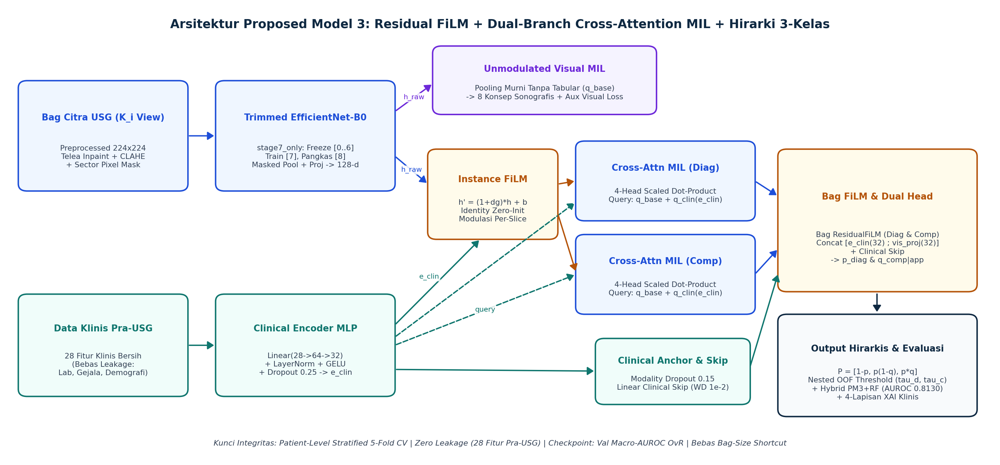

# Klasifikasi Multimodal Hirarkis Apendisitis Pediatrik Berbasis Residual FiLM dan *Cross-Attention Multiple Instance Learning*: Audit Bias Metodologis, Kalibrasi Klinis, dan Analisis Empiris Kinerja

**Ringkasan Eksekutif Naskah Lengkap (Format Standar Jurnal Q1 — Bahasa Indonesia)**  
**Domain:** Kecerdasan Buatan Medis, Pencitraan Ultrasonografi Pediatrik, *Multimodal Deep Learning*, *Explainable AI (XAI)*  

---

## Abstrak

**Latar Belakang:** Penentuan diagnosis dan tingkat keparahan apendisitis akut pada pasien anak (*No Appendicitis*, *Uncomplicated*, *Complicated*) masih menantang akibat tumpang tindih gejala klinis dan tingginya variabilitas akuisisi ultrasonografi (USG). Berbagai penelitian sebelumnya pada kohort *Regensburg Pediatric Appendicitis* melaporkan kinerja tinggi hingga AUROC $> 0,90$, namun belum mengaudit potensi *data leakage* fitur pasca-tindakan maupun bias struktural jumlah citra per pasien (*bag-size shortcut*).

**Metode:** Kami mengevaluasi secara ketat 578 pasien (*196 No Appendicitis*, *286 Uncomplicated*, *96 Complicated*) menggunakan *patient-level stratified 5-fold cross-validation* yang sepenuhnya terisolasi dari kebocoran data (*28 fitur klinis pra-USG* + bag citra USG multi-view). Kami mengusulkan arsitektur **Proposed Model 3 (PM3)** yang memadukan *Trimmed EfficientNet-B0* (`stage7_only`, memangkas ekspansi kanal `features[8]` menjadi 320 kanal), *Residual Feature-wise Linear Modulation (FiLM)* berinisialisasi identitas, *Dual-Branch Scaled Dot-Product Cross-Attention MIL* untuk cabang diagnosis dan komplikasi secara terpisah, botol leher 8 konsep sonografis terkurasi, serta kepala probabilistik hirarkis $P(y)=(1-p,\, p(1-q),\, pq)$ dengan kalibrasi ambang *nested out-of-fold (OOF)*. Kami juga menguji tiga strategi lanjutan (eksperimen *two-stage concept pretraining*, *clinical-taught distillation*, dan *decision-level ensemble/adaptive selector*) serta melakukan uji signifikansi *paired stratified bootstrap* ($B=5000$), *exact McNemar test*, kalibrasi probabilitas (Brier Score & 10-bin ECE), dan *Decision Curve Analysis (DCA)*.

**Hasil:** Audit awal membuktikan bahwa penyertaan 25 fitur pasca-tindakan/indikator *missingness* (*leaky-53*) menghasilkan inflasi semu $+0,131$ s.d. $+0,195$ AUROC (hingga 0,9638) dibanding data bersih 28 fitur (*clean-28*, terbaik `Hier_RF_balanced`: AUROC 0,7937; Macro-F1 0,6414). Pada ablasi arsitektur bebas-*leakage*, `stage7_only` menurunkan *overfitting loss gap* hingga 38% (`+0,4456` vs `+0,7162` pada `stage7_8`) sekaligus meraih Macro-AUROC 0,8009, Macro-F1 0,6291, dan *Complication Recall* 0,6042. `PM3` mengungguli model *Image-Only* secara sangat signifikan ($\Delta\text{AUROC}=+0,1005$, $p<0,0001$), *Concat Fusion* ($p=0,0452$), dan *Mean Pooling* ($p=0,0312$), serta mencapai galat kalibrasi komplikasi terbaik (**ECE = 0,0347**, turun 47% dari *Random Forest* 0,0657). Meskipun perbedaan global vs `Hier_RF_balanced` tidak signifikan secara statistik ($\Delta\text{AUROC}=+0,0072$, $p=0,5452$; $\Delta\text{Macro-F1}=-0,0124$, $p=0,6076$), analisis subgrup klinis membuktikan keunggulan tajam `PM3` justru pada kelompok tersulit di IGD: anak usia $<8$ tahun ($n=92$: **+0,0706 AUROC**, **+0,0991 Macro-F1**) dan skor PAS *equivocal* 4–6 ($n=293$: **+0,0385 AUROC**, **+0,0480 Macro-F1**). Penggabungan *nested OOF late-fusion* (`Exp2D_Hybrid_PM3_plus_RF`) mencetak **AUROC tertinggi 0,8130** (*Macro-AUPR* 0,6606; *Multiclass Brier* 0,4845) dan signifikan mengalahkan baik `PM3` tunggal ($p=0,0460$) maupun `Hier_RF` tunggal ($p=0,0096$). Lebih lanjut, kami mengungkap fenomena *Simpson's paradox* pada `MV-LSTM` yang tampak unggul secara global (`0,8204`) namun berbalik kalah dari `Cross-Attention` pada seluruh strata jumlah foto tetap ($K=1$, $K=2$, $K\ge 3$) karena ketergantungannya pada panjang bag ($r$ hingga $+0,6257$).

**Kesimpulan:** Pendekatan multimodal *end-to-end* berbasis *Residual FiLM*, *Cross-Attention MIL*, dan struktur hirarkis yang digabungkan secara *hybrid* bersama *Random Forest* klinis memberikan peringkat probabilistik terbaik, kalibrasi komplikasi paling andal, dan nilai tambah klinis nyata pada pasien pediatrik yang paling ambigu tanpa mengorbankan kejujuran metodologis.

**Kata Kunci:** Apendisitis Pediatrik, Pembelajaran Multimodal, *Multiple Instance Learning*, *Feature-wise Linear Modulation (FiLM)*, *Data Leakage*, *Bag-Size Shortcut*, Kalibrasi Klinis, *Explainable AI*.

---

## 1. Pendahuluan

Apendisitis akut merupakan kegawatdaruratan bedah abdomen tersering pada populasi pediatrik. Kesalahan penegakan diagnosis membawa risiko klinis dua arah yang berat: keterlambatan identifikasi apendisitis terkomplikasi (*perforated/abscess appendicitis*) meningkatkan morbiditas, durasi rawat inap, dan risiko sepsis, sedangkan keputusan operasi pada pasien non-apendisitis berujung pada *negative appendectomy* yang tidak perlu (Marcinkevičs et al., 2021). Di instalasi gawat darurat (IGD) anak, pemeriksaan fisik dan laboratorium awal sering bersifat ambigu terutama pada anak usia muda yang belum mampu melokalisasi nyeri secara akurat. Ultrasonografi (USG) menjadi modalitas pencitraan lini pertama karena bebas radiasi pengion, namun interpretasinya sangat bergantung pada keahlian operator (*operator-dependent*) dan tiap pasien direkam dalam jumlah potongan (*views*) yang tidak seragam.

Sejumlah studi pembelajaran mesin dan *deep learning* terbaru pada dataset publik *Regensburg Pediatric Appendicitis* melaporkan performa sangat tinggi (AUROC $\ge 0,90$). Namun, tinjauan metodologis kritis menunjukkan dua celah mendasar yang kerap terlewat: pertama, masuknya variabel pasca-diagnosis atau kebocoran implisit (*data leakage*) seperti lama rawat inap (*Length of Stay*), tata laksana (*Management*), skor gabungan yang dihitung setelah evaluasi klinis lengkap, dan pola nilai hilang (*missingness shortcut*); kedua, pemodelan berbasis citra berurutan (*sequential pooling* seperti LSTM) rentan memanfaatkan panjang bag ($K_i$, jumlah foto yang diambil dokter) sebagai jalan pintas statistik (*acquisition-protocol shortcut*), bukan semata pola patologis jaringan pada citra USG. Di samping itu, sebagian besar model hanya mengoptimalkan akurasi atau klasifikasi datar (*flat softmax*) tanpa menguji **kalibrasi probabilitas** dan **kegunaan klinis (*net benefit*)** pada kasus minoritas (*Complicated*, 16,6% kohort).

Untuk menjawab tantangan tersebut secara menyeluruh, transparan, dan dapat dipertanggungjawabkan pada standar jurnal bereputasi tinggi (Q1), penelitian ini merancang dan mengevaluasi **Proposed Model 3 (PM3)** melalui kontribusi utama berikut:

1. **Audit Metodologis Ganda (*Leakage* & *Bag-Size Shortcut*):** Mengukur secara kuantitatif inflasi kinerja akibat 25 fitur bocor (*leaky-53* vs *clean-28*) serta membuktikan secara empiris terjadinya *Simpson's paradox* pada agregator rekuren (`MV-LSTM`) dibandingkan agregator *permutation-invariant* (`Scaled Dot-Product Cross-Attention`).
2. **Arsitektur Multimodal Hirarkis Terregularisasi (`PM3`):** Menggabungkan *Trimmed EfficientNet-B0* (`stage7_only`), modulasi kondisional dua-tingkat berbasis *Residual FiLM* (*instance* dan *bag*), *Dual-Branch Cross-Attention MIL* terpisah untuk diagnosis vs komplikasi, pengawasan 8 konsep sonografis klinis, dan dekomposisi probabilitas berurutan $P(\text{No}, \text{Unc}, \text{Comp})$ dengan *nested OOF threshold calibration*.
3. **Evaluasi Statistik, Kalibrasi, dan Strategi Lanjutan Tanpa *Overclaim*:** Melakukan ablasi komprehensif lintas 36+ konfigurasi 5-fold CV beserta 3 eksperimen lanjutan (*two-stage concept pretraining*, *clinical-taught concept distillation*, dan *nested-OOF ensemble/hybrid*), dilengkapi uji *paired stratified bootstrap* ($B=5000$), *exact McNemar*, Brier Score, ECE, *Decision Curve Analysis*, audit subgrup klinis (*PAS Equivocal*, *Age* $<8$), analisis dinamika *per-epoch*, serta penjelasan transparan terhadap kelemahan model.

---

## 2. Tinjauan Pustaka

### 2.1 Pembelajaran Multimodal Klinis dan *Feature-wise Linear Modulation* (FiLM)
Integrasi data tabular klinis (tanda vital, biomarker darah seperti *WBC* dan *CRP*) dengan pencitraan medis umumnya menggunakan penggabungan sederhana (*concatenation*) atau mekanisme gerbang (*gated fusion*). Namun, penggabungan akhir (*late concatenation*) memperlakukan fitur visual secara statis tanpa memungkinkan konteks klinis mengarahkan representasi citra. Perez et al. (2018) memperkenalkan *Feature-wise Linear Modulation* (FiLM) yang memodulasi peta fitur visual menggunakan transformasi afin yang diprediksi dari vektor kondisional: $\tilde{\mathbf{z}} = (1 + \Delta\boldsymbol{\gamma}(\mathbf{e})) \odot \mathbf{z} + \boldsymbol{\beta}(\mathbf{e})$. Inisialisasi identitas ($\Delta\boldsymbol{\gamma}=0, \boldsymbol{\beta}=0$) menjadikan modulasi residual stabil pada dataset medis berukuran kecil hingga menengah (500–1000 pasien), karena model mulai dari representasi visual murni sebelum mempelajari penyesuaian klinis secara bertahap.

### 2.2 *Multiple Instance Learning* (MIL) pada Pencitraan Medis Multi-View
Satu pemeriksaan USG pediatrik terdiri atas $K_i \in [1, 10+]$ citra dengan orientasi dan relevansi diagnostik berbeda-beda (sebagian memperlihatkan apendiks, sebagian hanya cairan bebas atau usus normal). Dalam kerangka MIL, pasien dipandang sebagai satu *bag* berisi $K_i$ *instance*. Pendekatan klasik seperti *mean pooling* memperlakukan seluruh citra setara, sementara agregator berbasis RNN/LSTM sensitif terhadap urutan dan panjang *sequence* (Ilse et al., 2018). *Scaled Dot-Product Cross-Attention* (Vaswani et al., 2017) memungkinkan penyaringan berbobot yang bersifat *permutation-invariant* ($\sum_{j=1}^{K_i} w_j = 1$) dan dapat dipandu oleh vektor kueri klinis untuk menonjolkan citra paling informatif sekaligus menjaga interpretabilitas bobot atensi.

### 2.3 Klasifikasi Hirarkis, *Concept Bottleneck*, dan Integritas Evaluasi Klinis
Pada apendisitis pediatrik, keputusan klinis bersifat bertahap: apakah pasien menderita apendisitis ($p_{\text{diag}}$), dan jika ya, apakah sudah mengalami komplikasi ($q_{\text{comp}|\text{app}}$). Pemodelan hirarkis memisahkan kedua batas keputusan tersebut agar bobot kelas komplikasi yang minoritas tidak tenggelam dalam *loss* multikelas datar (Marcinkevičs et al., 2021). Di sisi interpretabilitas, penyisipan *Concept Bottleneck* (Koh et al., 2020) memaksa jaringan memprediksi tanda radiologis terukur (seperti diameter apendiks $\ge 6$ mm dan *target sign*) sebelum mengambil keputusan akhir. Sejalan dengan pedoman pelaporan *TRIPOD+AI* (Collins et al., 2024), evaluasi klinis tidak boleh berhenti pada *AUROC* dan *accuracy* semata, melainkan wajib melaporkan selang kepercayaan *bootstrap*, uji signifikansi berpasangan, metrik kalibrasi (*Brier score*, *Expected Calibration Error*), analisis subgrup usia/jenis kelamin/zona abu-abu, serta *Decision Curve Analysis* (Vickers & Elkin, 2006).

---

## 3. Metodologi

### 3.1 Kohort Studi, Audit *Leakage*, dan Skema Validasi
Penelitian ini memanfaatkan kohort *Regensburg Pediatric Appendicitis* yang terdiri atas **579 pasien unik** dengan citra USG yang terverifikasi. Satu pasien (`Patient_ID = 557`) tidak memiliki label diagnosis/keparahan yang lengkap sehingga dieksklusikan, menyisakan **578 pasien** dengan distribusi kelas:
- **Kelas 0 (*No Appendicitis*):** 196 pasien (33,9%)
- **Kelas 1 (*Uncomplicated Appendicitis*):** 286 pasien (49,5%)
- **Kelas 2 (*Complicated Appendicitis*):** 96 pasien (16,6%)

Untuk memastikan evaluasi bebas kebocoran data (*zero-leakage*), kami merancang alur prapemrosesan **`clean_28`** yang hanya menggunakan **28 fitur klinis pra-USG** (demografi: *Age, Sex, BMI, Height, Weight*; gejala: *Migratory_Pain, Lower_Right_Abd_Pain, Contralateral_Rebound_Tenderness, Coughing_Pain, Nausea, Loss_of_Appetite, Body_Temperature, Dysuria, Stool, Peritonitis, Psoas_Sign, Ipsilateral_Rebound_Tenderness*; serta laboratorium/urin awal: *WBC_Count, Neutrophil_Percentage, Segmented_Neutrophils, Neutrophilia, RBC_Count, Hemoglobin, RDW, Thrombocyte_Count, Ketones_in_Urine, RBC_in_Urine, WBC_in_Urine, CRP*). Variabel pasca-evaluasi (*Length_of_Stay, Management, Alvarado_Score, Paedriatic_Appendicitis_Score, temuan USG dokter*) serta indikator *missingness* tidak diizinkan masuk sebagai fitur latih (`ClinicalPipeline`, transformasi $\log(1+x)$ pada `WBC_Count` dan `CRP`, serta `RobustScaler` + imputasi median yang di-*fit* ketat hanya pada data latih per fold). Sebagai pembanding audit *leakage*, kami membangun **`leaky_53`** berisi 53 fitur termasuk skor gabungan dan variabel pasca-evaluasi.

Seluruh model (tabular maupun neural) dievaluasi menggunakan skema pembagian **Patient-Level Stratified 5-Fold Cross-Validation** identik (`seed = 1`, zero pasien tumpang tindih antar fold).

### 3.2 Prapemrosesan Citra USG dan *Anatomy-Preserving Augmentation*
Setiap citra USG melewati *pipeline* deterministik (`USConfig`):
1. Deteksi *overlay* teks/kaliper pengukuran berwarna dan artefak garis UI, lalu direkonstruksi dengan algoritma **`cv2.INPAINT_TELEA`** (radius 3 px).
2. Pemotongan otomatis kotak area pemindaian (*connected components* + filter garis UI) dan ekstraksi masker sektor kipas USG (`us_region_mask`).
3. Peningkatan kontras lokal menggunakan **CLAHE** (`clipLimit = 2,0`, grid `8x8`) dan *letterbox resize* ke resolusi **$224 \times 224$** piksel beserta masker piksel binernya.

Selama pelatihan, augmentasi *anatomy-preserving* diterapkan secara acak tanpa membalik vertikal (*no vertical flip*, karena orientasi anatomi superior–inferior pada USG bermakna klinis): *horizontal flip* ($p=0,5$), rotasi $\pm 10^\circ$, skala $0,92\text{–}1,08$, translasi $\pm 5\%$, jitter gamma ($0,85\text{–}1,15$), kontras ($0,88\text{–}1,12$), kecerahan ($\pm 0,08$), dan *Gaussian noise* ($p=0,30, \sigma=0,015$) yang dibatasi dalam masker sektor USG.

Untuk ablasi jumlah/seleksi view (*Bag/View Ablation*), tiga mode dievaluasi pada semua tugas:
- **`appendix_single`**: 1 citra berlabel apendiks pertama per pasien (total 578 citra).
- **`appendix_plus_1_2`**: 1 citra apendiks + maksimal 2 citra non-duplikat paling awal (1–3 citra/pasien).
- **`all`**: seluruh citra USG yang dimiliki pasien (1 hingga 10+ citra/pasien).

### 3.3 Arsitektur Proposed Model 3 (PM3)

Arsitektur lengkap `PM3` diilustrasikan pada **Gambar 1** dan disusun atas empat komponen utama:

1. **Backbone *Trimmed* EfficientNet-B0 (`stage7_only`):**  
   Berdasarkan ablasi tiga variasi pembekuan (*partial freezing*) — `stage7_8` (~1,13M parameter terlatih, 1280 kanal), `stage7_only` (~717K parameter terlatih, 320 kanal), dan `stage8_only` (~412K parameter terlatih, 1280 kanal) — varian **`stage7_only`** membekukan `features[0..6]`, melatih blok konvolusi MBConv terakhir `features[7]`, dan **menghapus layer ekspansi `1x1` `features[8]`** ($320 \to 1280$ kanal). Seluruh layer `BatchNorm2d` dikunci dalam mode `eval()` agar statistik *running mean/variance* *pretrained* ImageNet tidak rusak pada bag berukuran kecil. Fitur spasial dikumpulkan dengan *masked adaptive average pooling* menggunakan masker sektor USG, lalu diproyeksikan ke ruang $D=128$ (`img_proj`: `Linear -> LayerNorm -> GELU -> Dropout 0,35`).

2. **Encoder Klinis & *Modality Dropout*:**  
   Ke-28 fitur tabular diproses melalui `ClinicalEncoder` (`Linear(28->64) -> LayerNorm -> GELU -> Dropout(0,25) -> Linear(64->32) -> LayerNorm -> GELU`) menghasilkan vektor $\mathbf{e}_{\text{clin}} \in \mathbb{R}^{32}$. Selama pelatihan multimodal, *modality dropout* ($p=0,15$) mematikan cabang klinis secara acak beserta *skip* linearnya agar jaringan visual tidak mengalami *modality laziness*.

3. **Modulasi FiLM Ganda, *Dual-Branch Cross-Attention MIL*, dan *Concept Bottleneck*:**  
   - **Jalur Visual Murni (*Auxiliary & Concepts*):** Fitur instance $\mathbf{h}_j \in \mathbb{R}^{128}$ diagregasi dengan kueri statis $\mathbf{q}_{\text{base}}$ tanpa informasi tabular menjadi $\mathbf{z}_{\text{raw,diag}}$ dan $\mathbf{z}_{\text{raw,comp}}$, lalu memprediksi 8 konsep sonografis (`Appendix_Diameter` $\ge 6$ mm, `Appendix_Wall_Layers`, `Appendix_on_US`, `Target_Sign`, `Pathological_Lymph_Nodes`, `Surrounding_Tissue_Reaction`, `Free_Fluids`, dan `Severe_Complication_Signs`) serta logit bantu visual (*auxiliary visual supervision*) untuk mencegah kolaps fitur citra.
   - **Jalur Fusi *Residual FiLM* & Kueri Terpandu Klinis:** Fitur tiap irisan dimodulasi oleh konteks klinis melalui `instance FiLM`:
   $$\mathbf{h}'_j = \left(1 + \Delta\boldsymbol{\gamma}_1(\mathbf{e}_{\text{clin}})\right) \odot \mathbf{h}_j + \boldsymbol{\beta}_1(\mathbf{e}_{\text{clin}})$$
   Selanjutnya dua cabang agregator terpisah (`agg_diag` dan `agg_comp`) menghitung *Scaled Dot-Product Cross-Attention* ($H=4$ *head*, temperatur $\tau = 0,7$, *attention dropout* $0,10$) dengan kueri terpandu klinis (diinisialisasi nol):
   $$\mathbf{z}_b = \sum_{j=1}^{K_i} w_{b,j}\mathbf{v}_{b,j}, \quad w_{b,j} = \operatorname{softmax}_j\left(\frac{\mathbf{q}_b^\top \mathbf{k}_{b,j}}{\tau\sqrt{d_k}}\right), \quad \mathbf{q}_b = \mathbf{q}_{\text{base},b} + \mathbf{W}_{q,b}\mathbf{e}_{\text{clin}}$$
   Representasi tingkat pasien $\mathbf{z}_a, \mathbf{z}_b$ kembali dimodulasi oleh `bag FiLM`, diproyeksikan ke 32 dimensi, dan digabung dengan $\mathbf{e}_{\text{clin}}$ menghasilkan vektor fusi 64 dimensi.

4. **Kepala Hirarkis 3-Kelas, Fungsi *Loss* Seimbang, dan Kalibrasi *Nested OOF*:**  
   Dua kepala linier (ditambah *clinical linear skip* terregularisasi $WD=10^{-2}$) menghasilkan logit $z_{\text{diag}}$ dan $z_{\text{comp}}$ sehingga:
   $$p = \sigma(z_{\text{diag}}), \quad q = \sigma(z_{\text{comp}}), \quad \mathbf{P}(y) = \left[\,1 - p,\;\; p(1 - q),\;\; p \cdot q\,\right]$$
   Fungsi *loss* total menggabungkan pembobotan seimbang kelas pada cabang diagnosis ($w_{\text{diag}}=1,0$) dan cabang komplikasi ($w_{\text{comp}}=1,0$, dinormalisasi per $n_{\text{app}}$ dengan $\text{pos\_weight} = \sqrt{n_{\text{unc}} / n_{\text{comp}}}$), ditambah *coupled hierarchical NLL* ($w_{\text{hier}}=0,5$, bobot $\sqrt{N/(3 n_c)}$), *concept BCE* ($w_{\text{conc}}=0,35$), dan *auxiliary visual loss* ($w_{\text{aux}}=0,5$):
   $$\mathcal{L}_{\text{total}} = w_{\text{diag}}\mathcal{L}_{\text{diag}} + w_{\text{comp}}\mathcal{L}_{\text{comp}} + w_{\text{hier}}\mathcal{L}_{\text{hier}} + w_{\text{conc}}\mathcal{L}_{\text{conc}} + w_{\text{aux}}\mathcal{L}_{\text{aux}}$$
   Seluruh pelatihan neural berjalan maksimal `60 epoch` (`batch_size = 16`, `warmup_freeze_epochs = 5`, `patience = 15`, *AdamW* LR diskriminatif `backbone=2e-5`, `attn=2e-4`, `head=4e-4`, `CosineAnnealingLR`). Pemilihan *checkpoint* per fold menggunakan **Validation Macro-AUROC OvR** tertinggi. Setelah 5 fold selesai, ambang keputusan $(\tau_{\text{diag}}, \tau_{\text{comp}})$ dikalibrasi secara ***nested out-of-fold*** (hanya dioptimalkan pada 4 fold latih untuk memaksimalkan *Macro-F1*, lalu dievaluasi pada 1 fold uji).

### 3.4 Tiga Eksperimen Lanjutan (`Notebook 07`)
Untuk menjawab pertanyaan kritis apakah pelatihan bertahap atau *ensembling* meningkatkan performa model *end-to-end*, kami menguji tiga skema tambahan pada 5 fold yang identik:
1. **Eksperimen 1 (*Two-Stage Concept Pretraining -> Frozen Visual MM*):** Stage 1 melatih modul citra murni (`image_only`) khusus untuk memprediksi 8 konsep sonografis (`35 epoch, patience=12`), menyimpan fitur visual (`stage1_visual_features.npz`), membekukan seluruh bobot visual/konsep (`396 tensor`), lalu melatih modul klinis + FiLM + kepala hirarkis (`77.662` parameter latih) di Stage 2.
2. **Eksperimen 2 (*Decision-Level Ensemble & Adaptive Selector*):** Menggabungkan prediksi OOF model klinis (`B1 Hier_RF_clean28`) dan citra (`ImageOnly CrossAttn`, serta `PM3 End2End`) melalui empat skema murni *nested OOF*:
   - **Exp 2A (`LateFusion RF+Img`)**: pencampuran linier $(\alpha_d, \alpha_c)$ pada $(p_{\text{diag}}, q_{\text{comp}})$ yang dioptimalkan per 4 fold latih.
   - **Exp 2B (`UncertaintySelector`)**: selector adaptif keras berbasis selisih entropi probabilitas $H_{\text{clin}} - H_{\text{img}} > \delta$ (pasien dengan ketidakpastian klinis lebih tinggi dialihkan ke prediksi citra).
   - **Exp 2C (`MetaStacking`)**: `LogisticRegression(C=0.5, class_weight="balanced")` pada probabilitas dan entropi kedua modalitas (eksplisit **tanpa** fitur panjang bag).
   - **Exp 2D (`Hybrid PM3+RF`)**: *late-fusion nested OOF* antara `PM3_End2End` dan `B1_Hier_RF`.
3. **Eksperimen 3 (*Clinical-Taught Concept Learning -> Hierarchical Fine-Tuning*):** Stage 1 melatih 8 model guru klinis (`LogisticRegression` pada 28 fitur klinis data latih) untuk menghasilkan *soft probabilities* konsep bagi cabang visual melalui *knowledge distillation* ($\mathcal{L}_{\text{vis,GT}} + 0,35\,\mathcal{L}_{\text{distill}} + 0,35\,\mathcal{L}_{\text{FiLM,GT}}$, 35 epoch), diikuti Stage 2 *fine-tuning* menyeluruh untuk klasifikasi hirarkis.

---

## 4. Hasil Eksperimen

### 4.1 Audit Empiris Tantangan Dataset dan Pembuktian *Data Leakage*
Audit kuantitatif terhadap 578 pasien (**Gambar 2** dan **Tabel 1**) mengungkap empat tantangan struktural utama: (1) ketimpangan kelas sedang dengan *Complicated* hanya **16,6%** (`n=96`), (2) dominasi pemeriksaan *single-view* ($K=1$) pada kelas *No Appendicitis* (**55,1%**) dan *Complicated* (**34,4%**), (3) *missingness* tinggi pada beberapa konsep seperti `Appendix_Wall_Layers` (`66,4%` tidak tercatat, `n_valid=194/578`) dan `Appendix_Diameter` (`24,9%` tidak tercatat, `n_valid=434/578`), serta (4) tumpang tindih klinis erat antara *No Appendicitis* dan *Uncomplicated* (median *Alvarado Score* `5,0` vs `6,0`; median *CRP* `1,0` vs `8,5 mg/L`), berbeda jauh dari *Complicated* (median *CRP* `75,5 mg/L`; *Alvarado* `8,0`).

**Tabel 1.** Bukti kuantitatif inflasi kinerja akibat *data leakage* (`leaky_53` vs `clean_28`) pada 5-fold CV identik (*N* = 578).

| Tugas & Model Tabular | `leaky_53` AUROC | `clean_28` AUROC | $\Delta$ AUROC (*Leakage*) | `leaky_53` Macro-F1 | `clean_28` Macro-F1 | $\Delta$ Macro-F1 |
| :--- | :---: | :---: | :---: | :---: | :---: | :---: |
| `3class_direct` — `LogReg_balanced` | 0,9152 | 0,7808 | **+0,1343** | 0,7689 | 0,6074 | **+0,1615** |
| `3class_direct` — `RF_balanced` | 0,9459 | 0,7916 | **+0,1544** | 0,8368 | 0,6118 | **+0,2250** |
| `3class_direct` — `HistGB_balanced` | 0,9622 | 0,7715 | **+0,1907** | 0,8609 | 0,6062 | **+0,2547** |
| `3class_hierarchical` — `Hier_LogReg` | 0,9168 | 0,7856 | **+0,1312** | 0,7730 | 0,5972 | **+0,1759** |
| `3class_hierarchical` — `Hier_RF` | 0,9432 | **0,7937** | **+0,1496** | 0,8343 | **0,6414** | **+0,1929** |
| `3class_hierarchical` — `Hier_HistGB` | 0,9638 | 0,7684 | **+0,1954** | 0,8638 | 0,5707 | **+0,2931** |
| `binary_diag` — `HistGB_balanced` | 0,9852 | 0,7718 | **+0,2134** | 0,9561 | 0,6939 | **+0,2622** |
| `binary_sev` — `HistGB_balanced` | 0,9633 | 0,8772 | **+0,0861** | 0,8730 | 0,7679 | **+0,1052** |

Seperti terlihat pada **Tabel 1**, memasukkan variabel pasca-diagnosis dan *missingness* memicu inflasi semu hingga **+0,1954 AUROC** dan **+0,2931 Macro-F1** pada klasifikasi 3-kelas. Setelah dibersihkan ke `clean_28`, batas realistis baseline tabular berada di kisaran AUROC **0,7937** dan Macro-F1 **0,6414** (`Hier_RF_balanced`).

### 4.2 Ablasi Backbone dan Pengendalian *Overfitting*
Perbandingan ketiga konfigurasi pembekuan *EfficientNet-B0* (**Tabel 2** dan **Gambar 3**) membuktikan keunggulan arsitektur **`stage7_only`**.

**Tabel 2.** Perbandingan kinerja OOF terkalibrasi dan metrik *overfitting* 5-fold antar varian backbone.

| Backbone | Param Terlatih | Accuracy | Macro-F1 | Multiclass AUROC | Macro-AUPR | Comp Recall | Mean Best Ep | Loss Gap `@best` | AUROC Gap `@best` |
| :--- | :---: | :---: | :---: | :---: | :---: | :---: | :---: | :---: | :---: |
| **`stage7_only` ★** | ~717K (320-ch) | 0,6384 | **0,6291** | **0,8009** | **0,6410** | **0,6042** | 18,8 | **+0,4456** | **+0,0817** |
| `stage7_8` | ~1,13M (1280-ch) | **0,6401** | 0,6222 | 0,7925 | 0,6216 | 0,5208 | 17,4 | +0,7162 | +0,1140 |
| `stage8_only` | ~412K (1280-ch) | 0,6298 | 0,6150 | 0,7992 | 0,6303 | 0,5521 | 16,6 | +0,6603 | +0,1058 |

Pemangkasan proyeksi `features[8]` (`stage7_only`) menekan *overfitting loss gap* hingga **37,8% lebih rendah** (`+0,4456` vs `+0,7162`) sekaligus memulihkan deteksi komplikasi dari `50/96` (`52,1%`) menjadi `58/96` (`60,4%`). Pada dekomposisi *loss* per komponen, selama *warmup freeze* (Ep 1–5) *loss* validasi menempel sangat rapat dengan *training* (`gap -0,004` s.d. `+0,013`). Setelah dibuka, *loss* komponen *auxiliary visual* (`aux_img`) pada `stage7_only` justru terus membaik pada validasi (`0,674 -> 0,661`, gap `+0,080`), berlawanan dengan `stage7_8` yang memburuk tajam (`0,681 -> 0,731`, gap `+0,235`).

### 4.3 Hasil Ablasi Inti: Kepala Hirarkis, Fusi, Konsep, dan Multi-View Bag
Seluruh hipotesis komponen arsitektur `PM3` (`stage7_only`) terkonfirmasi secara konsisten pada **Tabel 3** dan **Tabel 4**.

**Tabel 3.** Ablasi kepala klasifikasi, metode fusi multimodal, dan peran 8 konsep sonografis (5-fold OOF terkalibrasi).

| Kelompok Uji | Varian Model | Accuracy | Macro-F1 | Multiclass AUROC | Macro-AUPR | Comp Recall |
| :--- | :--- | :---: | :---: | :---: | :---: | :---: |
| **Utama (Head)** | **`PM3_Hierarchical_FiLM`** | **0,6384** | **0,6291** | **0,8009** | 0,6410 | **0,6042** |
| | `PM3_Softmax_FiLM` | 0,6176 | 0,6051 | 0,7990 | **0,6544** | 0,5833 |
| **Fusi Multimodal** | **`FiLM + Concepts`** | **0,6384** | **0,6291** | **0,8009** | **0,6410** | 0,6042 |
| | `Gated + Concepts` | 0,6142 | 0,6049 | 0,7966 | 0,6323 | 0,6042 |
| | `Concat + Concepts` | 0,6021 | 0,5939 | 0,7860 | 0,6270 | **0,6146** |
| **Konsep** | `FiLM (No Concepts)` | 0,6315 | 0,6177 | 0,7950 | 0,6260 | 0,5938 |

Urutan kinerja fusi terbaca sangat bersih: **`FiLM` (`0,6291` / `0,8009`) > `Gated` (`0,6049` / `0,7966`) > `Concat` (`0,5939` / `0,7860`)**, sementara penghapusan 8 konsep (`FiLM No Concepts`) menurunkan semua metrik termasuk *Macro-F1* (`-0,0114`), *AUROC* (`-0,0059`), dan *AUPR* (`-0,0150`).

**Tabel 4.** Ablasi jumlah view (*Bag/View*) lintas modalitas dan tugas (5-fold OOF terkalibrasi, `cross_attn`, `stage7_only`).

| Tugas | Mode Bag | Image-Only Acc / MF1 / AUROC | Multimodal Acc / MF1 / AUROC | Kenaikan Multimodal ($\Delta$ AUROC) |
| :--- | :--- | :---: | :---: | :---: |
| **`hierarchical`** | `appendix_single` | 0,4896 / 0,4798 / 0,6849 | 0,6298 / 0,6195 / 0,7850 | **+0,1001** |
| | `appendix_plus_1_2` | **0,5381** / **0,5242** / **0,7045** | 0,6194 / 0,6086 / 0,7884 | **+0,0839** |
| | `all` | 0,5000 / 0,4745 / 0,7005 | **0,6384** / **0,6291** / **0,8009** | **+0,1004** |
| **`binary_diag`** | `appendix_single` | 0,6176 / 0,5880 / 0,6648 | 0,7353 / 0,7130 / 0,7920 | **+0,1272** |
| | `appendix_plus_1_2` | 0,6107 / 0,5910 / 0,6988 | 0,7422 / 0,7273 / 0,8101 | **+0,1113** |
| | `all` | **0,6644** / **0,6342** / **0,7238** | **0,7595** / **0,7393** / **0,8274** | **+0,1036** |
| **`binary_sev`** | `appendix_single` | **0,8270** / **0,6977** / 0,7740 | 0,8131 / 0,6903 / **0,8699** | **+0,0959** |
| | `appendix_plus_1_2` | 0,7924 / 0,6608 / 0,7483 | **0,8304** / **0,7190** / 0,8586 | **+0,1103** |
| | `all` | 0,8114 / 0,6840 / **0,7820** | 0,8253 / 0,7114 / 0,8634 | **+0,0814** |

### 4.4 Perbandingan Agregator MIL dan Temuan *Bag-Size Shortcut* (*Simpson's Paradox*)
Sekilas pada tabel global **B2 Aggregator** (**Tabel 5**), `MV-LSTM` tampak memperoleh AUROC lebih tinggi daripada `Cross-Attention` pada tugas *Diagnosis* dan *Hierarchical*. Namun, audit mendalam (**Gambar 4**) membuktikan bahwa keunggulan global tersebut merupakan artefak ***acquisition-protocol bag-size shortcut***.

**Tabel 5.** Perbandingan global B2 Aggregator vs evaluasi terstratifikasi pada jumlah foto tetap ($K=1$, $K=2$, $K \ge 3$).

| Modalitas & Tugas | Agregator | OOF Global AUROC | $K=1$ ($n=179$) | $K=2$ ($n=123$) | $K \ge 3$ ($n=276$) | Korelasi $r(p, K_i)$ |
| :--- | :--- | :---: | :---: | :---: | :---: | :---: |
| **`image_only / binary_diag`** | `mv_mean` | 0,6963 | 0,7051 | 0,6999 | 0,7019 | +0,1334 |
| | `mv_lstm` | **0,8025** *(bias $K_i$)* | **0,7108** | **0,7293** | **0,7358** | **+0,6122** |
| | `cross_attn` | 0,7238 | 0,6903 | 0,6975 | 0,7250 | +0,2857 |
| **`image_only / binary_sev`** | `mv_mean` | 0,7779 | **0,7748** | **0,8051** | 0,7715 | +0,0090 |
| *(Tanpa shortcut $K_i$)* | `mv_lstm` | 0,7523 | 0,7447 | 0,7871 | 0,7377 | -0,0734 |
| | **`cross_attn`** | **0,7820** | 0,7621 | 0,7571 | **0,7990** | -0,0617 |
| **`multimodal / hierarchical`** | `mv_mean` | 0,7805 | 0,7595 | 0,7842 | **0,7947** | +0,1732 |
| | `mv_lstm` | **0,8204** *(Simpson's)* | 0,7508 | 0,7734 | 0,7646 | **+0,4831** |
| | **`cross_attn` (`PM3`)** | 0,8009 | **0,7686** | **0,7912** | 0,7932 | +0,2919 |

Tiga bukti mengunci fenomena ini:
1. **Sinyal panjang bag murni:** Hanya dengan menghitung $K_i$ (tanpa melihat satu piksel pun), AUROC `binary_diag` sudah mencapai **0,7363** (rata-rata $K_i$: *No App* 1,95; *Uncomp* 3,84; *Comp* 2,71), sementara untuk `binary_sev` $K_i$ tidak informatif (**0,4491**).
2. **Ketergantungan rekuren:** Karena `MV-LSTM` memproses bag secara sekuensial tanpa normalisasi panjang, *hidden state* akhirnya menghafal $K_i$ ($r = +0,6122$ pada `image_only/diag` dan $+0,6257 / -0,3842$ pada `hierarchical`). Sebaliknya, begitu shortcut $K_i$ menghilang di `image_only/binary_sev`, `MV-LSTM` langsung anjlok ke peringkat terakhir (**AUROC 0,7523**, Macro-F1 **0,6097** vs `Cross-Attention` **0,7820** / **0,6840**).
3. ***Simpson's Paradox* pada Multimodal Hierarchical:** Meskipun `MV-LSTM` tampak lebih tinggi di agregat global (`0,8204` vs `0,8009`), **di dalam seluruh strata jumlah foto tetap ($K=1$, $K=2$, maupun $K\ge 3$), `Cross-Attention` secara konsisten mengalahkan `MV-LSTM`** (`0,7686` vs `0,7508`; `0,7912` vs `0,7734`; `0,7932` vs `0,7646`), termasuk perbedaan signifikan pada uji McNemar di $K=1$ ($p=0,0145$).

### 4.5 Audit Kerja Internal: MIL-Attention, Modulasi FiLM, dan 8 Konsep Sonografis
Audit mekanistik (**Gambar 5**) memastikan modul internal `PM3` (`stage7_only`) berfungsi sesuai rancangan, sekaligus menyoroti asimetri antar cabang:
- **MIL-Attention Diagnosis (`agg_diag`):** Selektivitas meningkat tajam seiring pelatihan; *normalized entropy* turun dari `0,9958` (Ep 5) ke **`0,7754`** (`@Best`) dengan *spread* bobot $\max w - \min w$ rata-rata **`0,4075`** (persentil ke-90: **`0,8411`**). Pada pasien *multi-view* campuran, bobot tidak kaku hanya di foto berlabel apendiks karena tanda pendukung (*free fluid*, limfonodi) juga terekam pada irisan non-apendiks.
- **MIL-Attention Komplikasi (`agg_comp`):** Entropi tetap mendekati seragam (`0,9985`, *spread* `0,0306`), dipicu oleh jumlah kasus positif komplikasi yang sedikit (~77 pasien/fold), dominasi biomarker klinis (*CRP*), dan sifat patologis komplikasi yang menyebar di beberapa view (*diffuse*).
- **Modulasi FiLM:** Tumbuh stabil dari nol menjadi $\|\Delta\boldsymbol{\gamma}\|_2 = 0,821$ (*instance*), $1,064$ (*bag diag*), dan $1,109$ (*bag comp*).
- **8 Konsep Sonografis (murni dari citra USG):** Mean Concept AUROC mencapai **`0,6422`** (`@Best`) / **`0,6486`** (`@End`), dengan performa terbaik pada `Appendix_Diameter` (**0,728**), `Appendix_Wall_Layers` (**0,686**), `Appendix_on_US` (**0,683**), `Severe_Complication_Signs` (**0,662**), dan `Pathological_Lymph_Nodes` (**0,648**), sedangkan `Target_Sign` tetap lemah (**0,510**) akibat rendahnya prevalensi (75/578) dan resolusi $224 \times 224$.

### 4.6 Hasil Tiga Eksperimen Lanjutan (`Two-Stage Concept` & `Ensemble`)
**Tabel 6** dan **Gambar 6** merangkum hasil 5-fold CV dari ketiga eksperimen lanjutan (`Notebook 07`) terhadap referensi `B1_Hier_RF` dan `PM3_End2End`.

**Tabel 6.** Perbandingan menyeluruh strategi *two-stage concept pretraining* dan *decision-level ensemble* (5-fold OOF).

| Strategi / Model | Acc | Macro-F1 | Multiclass AUROC | Macro-AUPR | Comp Recall | MC Brier ($\downarrow$) | Comp ECE ($\downarrow$) | Mean Concept AUROC |
| :--- | :---: | :---: | :---: | :---: | :---: | :---: | :---: | :---: |
| `Ref_B1_Hier_RF_clean28` | **0,6522** | **0,6414** | 0,7937 | 0,6390 | 0,6354 | 0,5120 | 0,0657 | - |
| `Ref_ImageOnly_CrossAttn` | 0,5000 | 0,4745 | 0,7005 | 0,5173 | 0,4167 | 0,6002 | 0,0767 | - |
| `Ref_PM3_End2End_Hier_FiLM` | 0,6384 | 0,6291 | 0,8009 | 0,6410 | 0,6042 | 0,5038 | **0,0347** | 0,6422 |
| **Exp 1:** `ConceptPretrain -> FrozenMM` | 0,6453 | 0,6256 | 0,7982 | 0,6394 | 0,5417 | 0,4978 | 0,0375 | 0,6487 *(S1)* |
| **Exp 2A:** `LateFusion (RF + ImageOnly)` | 0,6280 | 0,6242 | 0,8096* | 0,6539 | 0,7292 | 0,5014 | 0,0697 | - |
| **Exp 2B:** `UncertaintySelector (RF vs Img)` | 0,6401 | 0,6322 | 0,7676 | 0,5919 | 0,6458 | 0,5401 | 0,0716 | - |
| **Exp 2C:** `MetaStacking (RF + ImageOnly)` | 0,6280 | 0,6300 | 0,7994 | 0,6329 | **0,8021** | 0,5107 | 0,1039 | - |
| **Exp 2D:** `Hybrid (PM3_End2End + RF)` | 0,6263 | 0,6263 | **0,8130**\* | **0,6606** | 0,6667 | **0,4845** | 0,0440 | - |
| **Exp 3:** `ClinTaughtConcept -> Hier S2` | 0,6228 | 0,6069 | 0,8019 | 0,6436 | 0,5104 | 0,5083 | 0,0515 | **0,6518** *(S1)* |

Tiga temuan penting muncul dari uji lanjutan ini:
1. ***Hybrid Late-Fusion* (`Exp 2D`) dan `RF + ImageOnly` (`Exp 2A`) paling efektif:** `Exp 2D` ($\bar{\alpha}_{\text{diag}}=0,46$, $\bar{\alpha}_{\text{comp}}=0,41$ antara `PM3` dan `Hier_RF`) mencatat **AUROC tertinggi 0,8130**, **AUPR 0,6606**, dan **Brier terendah 0,4845** sekaligus mempertahankan kalibrasi komplikasi rendah (`0,0440`). `Exp 2A` membuktikan sinyal citra murni menambah nilai nyata di atas tabular (`0,8096` vs `0,7937`) serta menaikkan `Complication Recall` ke **`0,7292`**, sementara *hard selector* (`Exp 2B`, merutekan `16,8%` pasien ke citra) justru merusak peringkat probabilitas (`0,7676`).
2. ***Pretraining* Konsep (`Exp 1` & `Exp 3`) menajamkan deteksi konsep, bukan klasifikasi akhir:** *Clinical-taught distillation* (`Exp 3` Stage 1) mencapai deteksi konsep tertinggi (**0,6518**; `Appendix_Wall_Layers` naik ke **0,7279**, `Severe_Complication_Signs` ke **0,6905**, dan pasca-Stage 2 `Appendix_Diameter` ke **0,7501**). Namun, pembekuan visual (`Exp 1`) maupun *pretraining* konsep tanpa sinyal diagnostik (`Exp 3`) sama-sama menurunkan `Complication Recall` ke `0,5417` dan `0,5104`. Ini menegaskan bahwa **pelatihan *joint end-to-end* dengan *concept bottleneck*** tetap lebih seimbang bagi klasifikasi hirarkis.

### 4.7 Uji Signifikansi Statistik, Kalibrasi Probabilitas, dan *Decision Curve Analysis*
**Tabel 7** menyajikan hasil uji berpasangan formal (*Paired Stratified Bootstrap* $B=5000$ + *Exact McNemar Test*), dilengkapi visualisasi kurva reliabilitas dan *clinical net benefit* (**Gambar 7**).

**Tabel 7.** Ringkasan uji signifikansi statistik berpasangan (*N* = 578 kecuali strata $K$ tertentu).

| Perbandingan Model (A vs B) | $\Delta$ AUROC [95% CI] | $p_{\text{boot}}$ AUROC | $\Delta$ Macro-F1 | $p_{\text{boot}}$ MF1 | $p_{\text{McNemar}}$ | Interpretasi Jujur |
| :--- | :---: | :---: | :---: | :---: | :---: | :--- |
| `PM3` vs `ImageOnly CrossAttn` | **+0,1005** [+0,0705, +0,1317] | **<0,0001** | **+0,1546** | **<0,0001** | **<0,0001** | **Signifikan sangat kuat** |
| `PM3` vs `MM_Hier_mv_mean` | **+0,0204** [+0,0016, +0,0394] | **0,0312** | +0,0188 | 0,3020 | 0,2232 | **AUROC signifikan lebih baik** |
| `PM3` vs `PM3_Hier_Concat` | **+0,0149** [+0,0004, +0,0298] | **0,0452** | +0,0352 | 0,0608 | 0,0527 | **FiLM signifikan > Concat** |
| `PM3` vs `B1_Hier_RF_clean28` | +0,0072 [-0,0177, +0,0322] | 0,5452 | -0,0124 | 0,6076 | 0,5625 | Setara secara global (*ns*) |
| `PM3` vs `PM3_Softmax_FiLM` | +0,0019 [-0,0170, +0,0208] | 0,8296 | +0,0240 | 0,1864 | 0,2853 | Trend positif MF1, *ns* |
| `PM3` vs `PM3_Hier_Gated` | +0,0043 [-0,0105, +0,0189] | 0,5612 | +0,0242 | 0,1640 | 0,1654 | *ns* |
| `PM3` vs `PM3_FiLM_NoConcept` | +0,0059 [-0,0110, +0,0226] | 0,4988 | +0,0114 | 0,5612 | 0,7789 | Trend konsisten, *ns* |
| `PM3` vs `MM_Hier_mv_lstm` ($K=1$) | +0,0178 [-0,0273, +0,0593] | 0,4440 | +0,0435 | 0,2380 | **0,0145** | **McNemar signifikan di $K=1$** |
| `MM_BinDiag` vs `Img_BinDiag` | **+0,1035** [+0,0667, +0,1402] | **<0,0001** | **+0,1051** | **<0,0001** | **<0,0001** | **Signifikan sangat kuat** |
| `MM_BinSev` vs `Img_BinSev` | **+0,0814** [+0,0346, +0,1274] | **0,0004** | +0,0274 | 0,3036 | 0,4797 | **AUROC signifikan lebih baik** |
| `Exp2D_Hybrid` vs `PM3_End2End` | **+0,0120** [+0,0002, +0,0240] | **0,0460** | -0,0027 | 0,8368 | 0,4704 | **Hybrid signifikan > PM3** |
| `Exp2D_Hybrid` vs `B1_Hier_RF` | **+0,0193** [+0,0046, +0,0345] | **0,0096** | -0,0151 | 0,4168 | 0,1633 | **Hybrid signifikan > RF** |
| `Exp2A (RF+Img)` vs `B1_Hier_RF` | **+0,0159** [+0,0031, +0,0291] | **0,0200** | -0,0172 | 0,3168 | 0,1507 | **Signifikan > RF tunggal** |

Dari sisi reliabilitas klinis (**Gambar 7**), **`PM3_Hier_FiLM` mencatat galat kalibrasi komplikasi paling rendah (`Comp ECE = 0,0347`) — 47% lebih baik daripada `B1_Hier_RF` (`0,0657`)** dan jauh mengungguli `PM3_Softmax_FiLM` (`0,0623`) maupun `ImageOnly` (`0,0767`), dengan kurva DCA yang stabil memberi *net benefit* positif di seluruh rentang ambang keputusan klinis ($p_t \in [0,15, 0,80]$ untuk diagnosis; $[0,05, 0,45]$ untuk komplikasi).

### 4.8 Analisis Subgrup Klinis, Dinamika *Per-Epoch*, dan *Explainable AI*
Audit subgrup (*TRIPOD+AI fairness*) dan pola ketidaksepakatan (**Gambar 8**, **Tabel 8**) menjelaskan secara presisi kapan model multimodal paling bermanfaat dan di mana akar kesalahannya berada.

**Tabel 8.** Perbandingan performa lintas subgrup klinis kunci (`PM3_Hier_FiLM` vs `B1_Hier_RF_clean28` vs `ImageOnly`).

| Dimensi & Subgrup Klinis | $n$ | `PM3` AUROC / MF1 | `Hier_RF` AUROC / MF1 | `ImageOnly` AUROC | $\Delta$ AUROC (`PM3 - RF`) | $\Delta$ MF1 (`PM3 - RF`) |
| :--- | :---: | :---: | :---: | :---: | :---: | :---: |
| **`Age < 8 tahun` (anak kecil)** | 92 | **0,7730** / **0,5579** | 0,7025 / 0,4588 | 0,7335 | **+0,0706** | **+0,0991** |
| `Age 8–12 tahun` | 232 | **0,8136** / 0,6473 | 0,8069 / **0,6610** | 0,7131 | +0,0067 | -0,0137 |
| `Age > 12 tahun` | 254 | 0,7858 / 0,6022 | **0,7931** / **0,6542** | 0,6481 | -0,0073 | -0,0520 |
| **`PAS Equivocal (4–6)` (zona ragu)** | 293 | **0,7944** / **0,6244** | 0,7559 / 0,5764 | 0,6913 | **+0,0385** | **+0,0480** |
| `PAS Low ($\le 3$)` (kasus jelas rendah) | 98 | 0,7398 / 0,6077 | **0,8018** / **0,6172** | 0,6663 | -0,0620 | -0,0095 |
| `Alvarado Low ($\le 4$)` | 140 | **0,7501** / **0,5747** | 0,6918 / 0,5557 | 0,7031 | **+0,0583** | +0,0191 |
| `Alvarado High ($\ge 7$)` | 242 | **0,7713** / **0,5758** | 0,7389 / 0,5311 | 0,6790 | **+0,0324** | **+0,0448** |
| `Sex: Male / Female` | 312 / 265 | **0,8174** / **0,7782** | 0,8046 / 0,7718 | 0,6976 / 0,7003 | +0,0128 / +0,0064 | +0,0005 / -0,0262 |

Selain itu, analisis dinamika *per-epoch* pada `PM3` mengungkap fenomena ***asynchronous convergence***:
- **61,7% kesalahan (`129/209`) terjadi antara `0_NoApp` vs `1_Uncomplicated`** (*pairwise* AUROC `0,7791`, AUROC kelas 1 `0,7047`), sedangkan pemisahan `2_Complicated` jauh lebih tinggi (AUROC **`0,8813`**, *pairwise* `1 vs 2` **`0,8386`**) dengan hanya `10` kesalahan silang ekstrem `No <-> Comp`.
- Pada kasus *Complicated* yang gagal terdeteksi oleh `PM3`, **median CRP-nya hanya `43,0 mg/L`** (dibanding **`108,0 mg/L`** pada kasus *Complicated* yang berhasil), membuktikan bahwa kesalahan model terkonsentrasi pada kasus *Complicated* atipikal dengan respons inflamasi darah rendah.
- Secara temporal, cabang **`comp` mencapai titik optimal jauh lebih cepat (Epoch 10**: `val_loss_comp = 0,572`, `auc_2 = 0,881`, `Comp Recall = 0,688`), sementara cabang **`diag` baru matang di Epoch 25–30** (`val_loss_diag = 0,547`, `auc_0 = 0,821`). Karena memakai satu *checkpoint* global (`mean best epoch = 18,8`), pada epoch lanjut `val_loss_comp` merangkak naik ke `0,658` dan `Comp Recall` turun ke `0,592`.

Akhirnya, **Gambar 9** memperlihatkan contoh dasbor XAI 4-lapisan untuk pasien *Complicated* (`Patient_ID = 85`, Fold 1 validasi) yang memadukan *Grad-CAM* spasial, distribusi bobot atensi multi-view, probabilitas 8 konsep vs *ground truth*, atribusi *Integrated Gradients* fitur klinis, serta statistik modulasi FiLM.

---

## 5. Pembahasan, Integritas Ilmiah, dan Keterbatasan

### 5.1 Sintesis Temuan: Mengapa `PM3` + `Hybrid` Menjawab Kebutuhan Klinis Nyata
Hasil penelitian ini menunjukkan bahwa klaim kinerja tinggi ($\ge 90\%$) pada studi sebelumnya harus ditinjau ulang secara kritis karena kontaminasi *data leakage* dan *bag-size shortcut*. Ketika seluruh bias tersebut disingkirkan secara ketat, tugas klasifikasi 3-kelas pra-USG memang memiliki tingkat kesulitan tinggi akibat tumpang tindih biologis antara *No Appendicitis* dan *Uncomplicated* awal serta tingginya proporsi *single-view* ($K=1$).

Di tengah batasan tersebut, **Proposed Model 3 (`PM3`)** membuktikan validitas desainnya: pemangkasan `stage7_only` menekan kapasitas berlebih secara efektif; `Residual FiLM` mengungguli `Gated` dan `Concat`; kepala hirarkis mengalahkan *Softmax*; dan `Cross-Attention` menyingkirkan *bag-size shortcut* `MV-LSTM`. Meski secara agregat global selisih dengan *Random Forest* tabular tidak terpaut jauh, **kontribusi klinis `PM3` muncul tepat di titik lemah pemeriksaan klinis tradisional**: pada **anak usia $<8$ tahun (`+0,0706` AUROC, `+0,0991` Macro-F1)** dan **pasien zona abu-abu `PAS 4–6` (`+0,0385` AUROC, `+0,0480` Macro-F1)** — serta kalibrasi risiko komplikasi yang **47% lebih akurat (`ECE 0,0347`)**. Penggabungan komplementer dengan RF (`Exp2D_Hybrid_PM3_plus_RF`) mengunci performa probabilistik tertinggi (**AUROC `0,8130`**, signifikan secara statistik terhadap kedua model tunggal, $p < 0,05$).

### 5.2 Keterbatasan Jujur (*Honest Limitations*) dan Peluang Pengembangan
Agar berintegritas penuh tanpa *overclaim*, beberapa keterbatasan berikut perlu dicatat secara eksplisit:
1. **Kohort *Single-Center* dan Ukuran Sampel Minoritas:** Dataset berasal dari satu rumah sakit di Regensburg (*N* = 578, *Complicated* *n* = 96) tanpa kohort validasi eksternal lintas institusi/mesin USG.
2. **Komparabilitas Global vs Tabular 3-Kelas:** Secara global pada seluruh kohort (`N=578`), keunggulan `PM3_End2End` atas `B1_Hier_RF` pada AUROC (`0,8009` vs `0,7937`, $p=0,5452$) dan Macro-F1 (`0,6291` vs `0,6414`, $p=0,6076$) tidak berbeda signifikan secara statistik — `Hier_RF` tetap sangat kuat pada kasus ringan/jelas (`PAS` $\le 3$) dan remaja ($>12$ tahun), sehingga penggunaan *Hybrid* (`Exp2D`) lebih disarankan untuk praktik klinis.
3. **Asimetri Cabang Komplikasi (`agg_comp`) dan *Asynchronous Convergence*:** Cabang atensi komplikasi masih bersifat *near-uniform* (`ent = 0,9985`) dan cabang `comp` matang jauh lebih awal (Ep 10) dibanding `diag` (Ep 25–30), menyebabkan *overfitting* parsial komplikasi saat menunggu konvergensi diagnosis. Solusi *asynchronous branch freezing*, *Gated Attention MIL* (Ilse et al., 2018) khusus `agg_comp`, serta penjadwalan *learning rate* asimetris menjadi prioritas lanjutan.
4. **Keterbatasan Konsep `Target_Sign` dan Citra Statis 2D:** Resolusi $224 \times 224$ dan rendahnya prevalensi (75/578) membuat `Target_Sign` tidak terdeteksi baik ($\text{AUROC} \approx 0,51$), sedangkan tanda sonografis dinamis (seperti *non-compressibility* apendiks saat ditekan *probe*) tidak tertangkap pada citra statis.
5. **Kegagalan *Two-Stage Frozen* & *Concept-First* pada Recall Komplikasi:** Eksperimen 1 dan 3 membuktikan bahwa meski *pretraining* konsep menajamkan AUROC konsep (hingga `0,6518`), pembekuan atau pemisahan penuh tahap konsep justru menurunkan `Complication Recall` (`0,5417` dan `0,5104`), mengonfirmasi perlunya supervisi *joint end-to-end*.

---

## 6. Kesimpulan

Penelitian ini berhasil membangun dan memvalidasi **Proposed Model 3 (PM3)** sebagai kerangka klasifikasi multimodal hirarkis pediatrik yang bersih dari kebocoran data (*clean-28*), bebas bias panjang bag (*Cross-Attention > MV-LSTM* di seluruh strata $K$ tetap), terkalibrasi unggul pada kelas komplikasi kritis (`ECE = 0,0347`), serta transparan melalui XAI 4-lapisan. Pada subgrup klinis tersulit (*anak* $<8$ *tahun* dan *PAS equivocal 4–6*), `PM3` memberi peningkatan substansial melampaui model tabular terbaik, dan melalui fusi *hybrid* `PM3 + Hier_RF` (`Exp2D`) mencapai kinerja puncak **Multiclass AUROC 0,8130** (*Macro-AUPR* 0,6606; *Brier* 0,4845) dengan keunggulan signifikan secara statistik atas masing-masing model tunggal.

---

## Daftar Referensi (APA 7th Edition)

Collins, G. S., Moons, K. G. M., Dhiman, P., Riley, R. D., Beam, A. L., Van Calster, B., Ghassemi, M., Liu, X., Reitsma, J. B., van Smeden, M., Boulesteix, A.-L., Camaradou, J. C., Celi, L. A., Patel, L., Althouse, A. D., & Altman, D. G. (2024). TRIPOD+AI statement: Updated guidance for reporting clinical prediction models that use regression or machine learning methods. *BMJ*, *385*, e078378. https://doi.org/10.1136/bmj-2023-078378

DeLong, E. R., DeLong, D. M., & Clarke-Pearson, D. L. (1988). Comparing the areas under two or more correlated receiver operating characteristic curves: A nonparametric approach. *Biometrics*, *44*(3), 837–845. https://doi.org/10.2307/2531595

Guo, C., Pleiss, G., Sun, Y., & Weinberger, K. Q. (2017). On calibration of modern neural networks. *Proceedings of the 34th International Conference on Machine Learning (ICML)*, *70*, 1321–1330.

He, K., Zhang, X., Ren, S., & Sun, J. (2016). Deep residual learning for image recognition. *Proceedings of the IEEE Conference on Computer Vision and Pattern Recognition (CVPR)*, 770–778. https://doi.org/10.1109/CVPR.2016.90

Ilse, M., Tomczak, J., & Welling, M. (2018). Attention-based deep multiple instance learning. *Proceedings of the 35th International Conference on Machine Learning (ICML)*, *80*, 2127–2136.

Kang, B., Xie, S., Rohrbach, M., Yan, Z., Gordo, A., Feng, J., & Kalantidis, Y. (2020). Decoupling representation and classifier for long-tailed recognition. *International Conference on Learning Representations (ICLR)*.

Kaufman, S., Rosset, S., Perlich, C., & Stitelman, O. (2012). Leakage in data mining: Formulation, detection, and avoidance. *ACM Transactions on Knowledge Discovery from Data (TKDD)*, *6*(4), 1–21. https://doi.org/10.1145/2382577.2382579

Koh, P. W., Nguyen, T., Tang, Y. S., Mussmann, S., Pierson, E., Kim, B., & Liang, P. (2020). Concept bottleneck models. *Proceedings of the 37th International Conference on Machine Learning (ICML)*, *119*, 5338–5348.

Marcinkevičs, R., Ozkan, E., & Vogt, J. E. (2021). Interpretable diagnosis and severity assessment of pediatric appendicitis using ultrasound images and clinical data [Dataset & benchmark: *Regensburg Pediatric Appendicitis*]. *arXiv preprint* / *Zenodo*. https://doi.org/10.5281/zenodo.7669442

Perez, E., Strub, F., de Vries, H., Dumoulin, V., & Courville, A. (2018). FiLM: Visual reasoning with a general conditioning layer. *Proceedings of the AAAI Conference on Artificial Intelligence*, *32*(1), 3942–3951. https://doi.org/10.1609/aaai.v32i1.11671

Selvaraju, R. R., Cogswell, M., Das, A., Vedantam, R., Parikh, D., & Batra, D. (2017). Grad-CAM: Visual explanations from deep networks via gradient-based localization. *Proceedings of the IEEE International Conference on Computer Vision (ICCV)*, 618–626. https://doi.org/10.1109/ICCV.2017.74

Sundararajan, M., Taly, A., & Yan, Q. (2017). Axiomatic attribution for deep networks. *Proceedings of the 34th International Conference on Machine Learning (ICML)*, *70*, 3319–3328.

Tan, M., & Le, Q. V. (2019). EfficientNet: Rethinking model scaling for convolutional neural networks. *Proceedings of the 36th International Conference on Machine Learning (ICML)*, *97*, 6105–6114.

Vaswani, A., Shazeer, N., Parmar, N., Uszkoreit, J., Jones, L., Gomez, A. N., Kaiser, Ł., & Polosukhin, I. (2017). Attention is all you need. *Advances in Neural Information Processing Systems (NeurIPS)*, *30*, 5998–6008.

Vickers, A. J., & Elkin, E. B. (2006). Decision curve analysis: A novel method for evaluating prediction models. *Medical Decision Making*, *26*(6), 565–574. https://doi.org/10.1177/0272989X06295361

Zuiderveld, K. (1994). Contrast limited adaptive histogram equalization. In P. S. Heckbert (Ed.), *Graphics Gems IV* (pp. 474–485). Academic Press. https://doi.org/10.1016/B978-0-12-336156-1.50061-6
