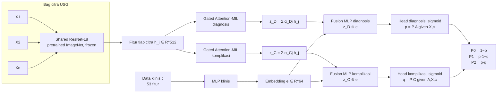
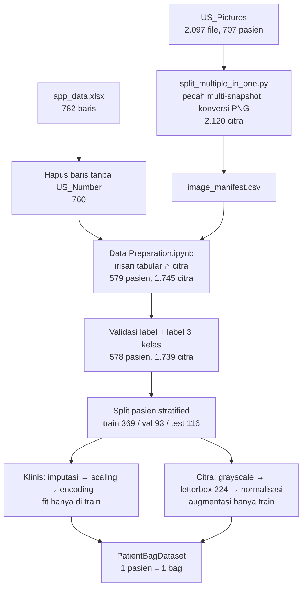

# Hierarchical Multimodal Classification of Pediatric Appendicitis Using Dual-Branch Attention-Based Multiple Instance Learning

| | |
|---|---|
| **Nama** | Adnan Fauzan Ramdhani |
| **NRP** | 6025261004 |
| **Mata Kuliah** | Topik Dalam Pengolahan Citra Digital |
| **Universitas** | Institut Teknologi Sepuluh Nopember (ITS) |
| **Dataset** | Regensburg Pediatric Appendicitis Dataset v1.03 (Marcinkevičs dkk., 2023) |

Penelitian ini mengklasifikasikan apendisitis pada anak ke dalam tiga kelas (**non-apendisitis**, **uncomplicated appendicitis**, **complicated appendicitis**). Model menggabungkan **data klinis** pasien dengan **sekumpulan citra USG** (satu pasien = satu *bag* berisi 1 atau lebih citra) melalui dua cabang *attention-based Multiple Instance Learning* (MIL) dan output hierarkis diagnosis → komplikasi.

---

## Daftar Isi

1. [Latar Belakang](#1-latar-belakang)
2. [Penelitian Sebelumnya dan Gap Penelitian](#2-penelitian-sebelumnya-dan-gap-penelitian)
3. [Proposed Method](#3-proposed-method)
4. [Alur Proposed Method dan Formulasi Matematika](#4-alur-proposed-method-dan-formulasi-matematika)
5. [Preprocessing Data](#5-preprocessing-data)
6. [53 Fitur Klinis](#6-53-fitur-klinis)
7. [Distribusi Citra Appendix per Pasien](#7-distribusi-citra-appendix-per-pasien)
8. [Ringkasan Hasil Experiment 1](#8-ringkasan-hasil-experiment-1)
9. [Struktur Repositori dan Cara Menjalankan](#9-struktur-repositori-dan-cara-menjalankan)
10. [Referensi](#10-referensi)

---

## 1. Latar Belakang

**Apendisitis pediatrik** adalah peradangan apendiks pada anak dan remaja. Gejalanya dapat berupa nyeri perut, mual, demam, dan penurunan nafsu makan. Gejala yang tidak khas sering menyulitkan diagnosis (Di Saverio dkk., 2020).

**Diagnosis oleh dokter.** Dokter menggabungkan anamnesis, pemeriksaan fisik, hasil laboratorium (leukosit/neutrofil dan CRP), serta pencitraan. *Alvarado Score* dan *Pediatric Appendicitis Score* (PAS) membantu stratifikasi risiko. Pada anak, USG menjadi pemeriksaan pencitraan awal.

**Penilaian keparahan.** Dokter menilai tanda komplikasi dari pemeriksaan dan citra USG, lalu dari temuan operasi atau histopatologi bila tersedia. Perforasi, abses, dan peritonitis purulen menandai penyakit yang lebih kompleks. Skor klinis saja belum cukup untuk memastikan diagnosis.

**Peran AI.** AI dapat mempelajari pola data klinis dan citra USG untuk menghasilkan estimasi probabilitas diagnosis dan status komplikasi pada tingkat pasien. Estimasi ini menjadi informasi tambahan bagi dokter, bukan pengganti penilaian klinis (Marcinkevičs dkk., 2024; Barthwal dkk., 2026).

**Tujuan penelitian.** Mengembangkan model yang menggabungkan data klinis dengan satu atau lebih citra USG melalui attention-MIL, lalu menghasilkan klasifikasi hierarkis apendisitis: non-apendisitis, uncomplicated appendicitis, dan complicated appendicitis.

### Dataset: Regensburg Pediatric Appendicitis Dataset

Studi retrospektif di Children's Hospital St. Hedwig, Regensburg, Jerman, pada pasien anak/remaja dengan dugaan apendisitis periode 2016–2021 (dirilis 2023, UCI/Zenodo).

| Komponen | Isi |
|---|---|
| `app_data.xlsx` | Sheet *All cases*: data pasien (58 kolom). Sheet *Data Summary*: definisi, tipe, dan waktu pengukuran variabel |
| `US_Pictures/` | Citra B-mode USG dengan beberapa view anatomi; dipasangkan ke data klinis melalui `US_Number` |
| `multiple_in_one` | Daftar nama citra yang berisi beberapa snapshot dalam satu file |

| Data mentah | Jumlah |
|---|---|
| Baris data klinis (`app_data.xlsx`) | 782 |
| — dengan `US_Number` | 760 |
| Pasien dengan citra USG | 707 |
| Total file citra USG | 2.097 (BMP 2.064, PNG 31, JPG 2) |
| Citra per pasien (rata-rata / median / min / maks) | 2,97 / 2 / 1 / 19 |

Target asli dataset adalah **Diagnosis**, **Severity**, dan **Management**. Penelitian ini menggabungkan Diagnosis dan Severity menjadi target tiga kelas.

---

## 2. Penelitian Sebelumnya dan Gap Penelitian

### Literatur citra dan fusi multimodal

| Penelitian | Input dan model | Target | Kelebihan | Kekurangan / batas cakupan |
|---|---|---|---|---|
| **Marcinkevičs dkk. (2024)**, *Medical Image Analysis* (Q1) | Multi-view USG; Mean/LSTM; MVCBM dan SSMVCBM | Diagnosis biner, management, severity | Menangani beberapa view dan konsep yang tidak lengkap; konsep dapat diperiksa dan diintervensi | Memakai citra/konsep USG tanpa fusi fitur klinis; LSTM sensitif terhadap urutan citra |
| **Barthwal dkk. (2026)**, *Egyptian Pediatric Association Gazette* | Klinis + citra USG; TabNet + ResNet-18; cross-attention | Diagnosis biner | Menggabungkan dua modalitas dan menyediakan XAI; split berdasarkan pasien | Fusi hanya memakai satu citra input; kriteria pemilihan citra tidak dijelaskan; belum ada output diagnosis–komplikasi hierarkis |
| **Fernández Santana dkk. (2026)**, *Knowledge-Based Systems* (Q1) | Citra USG; StyleGAN2-ADA + Swin Transformer | Diagnosis biner | Split pasien, augmentasi GAN pada training, evaluasi statistik | Hanya klasifikasi citra tanpa fusi klinis atau keparahan; augmentasi tidak jelas meningkatkan AUC |

### Literatur model tabular

| Penelitian | Input dan model | Target | Kelebihan | Kekurangan / batas cakupan |
|---|---|---|---|---|
| **Chadaga dkk. (2024)**, *Scientific Reports* (Q1) | Klinis/temuan USG tabular; APPSTACK + tuning + XAI | Diagnosis biner | Membandingkan beberapa classifier dan lima metode XAI | Tanpa citra mentah; lama rawat tidak tersedia saat diagnosis awal; balancing sebelum split berisiko leakage |
| **Manohar dkk. (2025)**, *Telematics and Informatics Reports* (Q1) | Klinis/lab/temuan USG tabular; ML ensemble + XAI | Severity biner dan management | Memodelkan keparahan dan penanganan secara langsung | Tanpa citra mentah atau output hierarkis; lama rawat menjadi fitur penting padahal diukur saat pulang |
| **Dyuthishree dkk. (2026)**, *Healthcare Analytics* (Q1) | Tabular; Boruta + oversampling + soft voting + XAI | Diagnosis presumptif dan peritonitis | Seleksi fitur dan penjelasan prediksi | Target berbeda dari diagnosis akhir/Severity; tanpa citra mentah |

### Literatur VLM dan eksplorasi kelompok

| Penelitian | Input dan model | Target | Kelebihan | Kekurangan / batas cakupan |
|---|---|---|---|---|
| **Altintas Mese dkk. (2026)**, *Pediatric Radiology* (Q1) | Hingga 4 citra USG, teks temuan, dan klinis; Llama 4 Maverick zero-shot | Diagnosis biner tingkat pasien | Membandingkan kombinasi input tanpa pelatihan khusus | Citra saja memiliki spesifisitas rendah; menambah citra tidak memberi perbaikan bermakna; belum ada MIL atau keparahan |
| **Failli dkk. (2025)**, *Journal of Classification* (Q1) | Kondisi klinis biner; bipartite network, mixture latent trait | Biclustering pasien dan kondisi | Mengidentifikasi kelompok pasien dan pola kondisi klinis | Tujuan eksplorasi, bukan prediksi; tanpa citra USG |

### Penelitian utama yang menjadi acuan

1. **Marcinkevičs dkk. (2024) – agregasi multiview.** MVCBM/SSMVCBM mengolah beberapa citra pasien melalui encoder bersama, agregasi mean atau LSTM, lalu *concept bottleneck*. *Kelemahan:* belum ada cabang fitur klinis; mean memberi bobot sama pada setiap view; LSTM bergantung pada urutan citra. *Peran usulan:* menambah cabang klinis dan dua attention-MIL (diagnosis dan komplikasi) yang tidak bergantung pada urutan citra, dengan output hierarkis.
2. **Barthwal dkk. (2026) – fusi klinis dan citra.** ResNet-18 untuk citra, TabNet untuk klinis, cross-attention untuk diagnosis biner. *Kelemahan:* agregasi antar-citra menjadi satu representasi pasien belum dirinci; belum ada output status komplikasi. *Peran usulan:* satu pasien = satu bag citra, agregasi view dengan attention-MIL, lalu digabung dengan data klinis untuk membentuk probabilitas tiga kelas.
3. **Fernández Santana dkk. (2026) – klasifikasi citra USG.** StyleGAN2-ADA + Swin Transformer dengan split pasien. *Kelemahan:* hanya citra, tanpa fusi klinis atau keparahan. *Peran usulan:* bag citra + informasi klinis untuk prediksi tingkat pasien, dengan split pasien dan preprocessing yang di-*fit* hanya pada data training.

### Gap penelitian

1. **Diagnosis dan status komplikasi dalam satu pipeline.** Diagnosis dan keparahan sudah diteliti, tetapi pada delapan artikel di atas fusi klinis–bag citra dengan probabilitas diagnosis–komplikasi hierarkis belum dievaluasi secara eksplisit.
2. **Fusi multimodal pada tingkat pasien.** Fusi klinis–citra yang ada hanya menggabungkan fitur klinis dengan satu input citra, dan pemilihan citranya tidak dijelaskan. VLM memakai beberapa citra melalui prompting. Usulan ini mempelajari bobot seluruh view dalam satu bag.
3. **Agregasi multiview dan informasi klinis.** MVCBM memakai citra/konsep USG dengan mean pooling atau LSTM. Usulan ini menggabungkan fitur klinis dan attention khusus tiap tugas tanpa bergantung pada urutan input.

---

## 3. Proposed Method

**Multimodal Dual-Branch Attention-MIL dengan output hierarkis.**

Unit analisis adalah **satu pasien** dengan satu vektor data klinis $\mathbf{c}$ dan satu bag citra USG $\{X_1, \dots, X_n\}$, $n \ge 1$.



Komponen utama:

| Komponen | Konfigurasi (implementasi di `multimodal_mil_model.py`) |
|---|---|
| Encoder citra | ResNet-18 bersama (shared) untuk semua citra; lapisan klasifikasi dibuang dan diganti *global average pooling* → $\mathbf{h}_j \in \mathbb{R}^{512}$ (tanpa proyeksi tambahan) |
| Agregasi bag | Dua *gated attention-MIL* terpisah (diagnosis dan komplikasi), dimensi attention 128, padding di-*mask* |
| Encoder klinis | MLP: BatchNorm → Linear(53→128) → ReLU → Dropout → Linear(128→64) → ReLU |
| Fusion | Dua MLP terpisah, masing-masing Linear(576→256) → ReLU → Dropout → Linear(256→64) → ReLU → Dropout |
| Head | Dua head sigmoid: $p$ (diagnosis) dan $q$ (komplikasi bersyarat apendisitis) |
| Loss | BCE diagnosis untuk seluruh pasien + BCE komplikasi hanya untuk pasien apendisitis |

**Model terbaik (S26)** dari pencarian 36 skenario: ResNet-18 *pretrained* ImageNet dalam keadaan **frozen**, optimizer **Adam**, learning rate $10^{-3}$, dropout 0,2, weight decay $10^{-4}$, batch 16, maksimum 100 epoch, *early stopping* patience 25 pada macro-F1 validasi.

### Pencarian 36 skenario (fine tuning)

3 kondisi backbone × 3 optimizer × 4 profil hyperparameter = 36 skenario (bukan grid penuh).

| Profil | Learning rate | Dropout | Weight decay |
|---|---|---|---|
| P1 | 1e-4 | 0,4 | 1e-3 |
| P2 | 1e-3 | 0,2 | 1e-4 |
| P3 | 1e-5 | 0,7 | 1e-3 |
| P4 | 1e-4 | 0,7 | 1e-4 |

| Kondisi backbone | Pretrained | Backbone dilatih | LR backbone |
|---|---|---|---|
| Scratch | Tidak | Ya | 1 × LR utama |
| Pretrained trainable | ImageNet | Ya | 0,1 × LR utama |
| Pretrained frozen | ImageNet | Tidak (mode eval) | – |

Optimizer: Adam, AdamW, dan SGD (momentum 0,9, Nesterov). Seed 1. Checkpoint terbaik dipilih dari macro-F1 validasi tertinggi; jika sama, dipilih validation loss yang lebih rendah.

### Model pembanding yang dijalankan

| Notebook | Model | Tujuan |
|---|---|---|
| `MIL-Attention Dual Fusion MLP Hierarchical` | **Model usulan**: dual attention + dua head hierarkis (36 skenario) | Model utama |
| `MIL-Attention Dual Fusion MLP Softmax` | Dual attention + satu head softmax 3 kelas | Pembanding formulasi hierarkis vs klasifikasi langsung |
| `MIL-Attention MLP Binary Diagnosis S26` | Multimodal biner: appendicitis vs no appendicitis | Pembanding dengan literatur (diagnosis) |
| `MIL-Attention MLP Binary Severity S26` | Multimodal biner: complicated vs (uncomplicated + no appendicitis) | Pembanding dengan literatur (severity) |
| `Independent MIL-Attention and MLP` | MLP klinis mandiri dan MIL-Attention citra mandiri | Kontribusi tiap modalitas |

---

## 4. Alur Proposed Method dan Formulasi Matematika

### 4.1 Input

Untuk pasien ke-$i$:

- Data klinis $\mathbf{c}_i \in \mathbb{R}^{53}$ (setelah imputasi, scaling, dan encoding; lihat [Bagian 5](#5-preprocessing-data)).
- Bag citra $\mathcal{B}_i = \{X_{i1}, \dots, X_{in_i}\}$, $1 \le n_i \le 15$, setiap $X_{ij} \in \mathbb{R}^{3 \times 224 \times 224}$.
- Label: $y^{A}_i \in \{0,1\}$ (apendisitis) dan $y^{C}_i \in \{0,1,-1\}$ (komplikasi; $-1$ bila bukan apendisitis).

Dalam satu batch berukuran $B$, bag di-*padding* nol hingga $N = \max_i n_i$ dengan mask $m_{ij} = 1$ untuk citra asli dan $0$ untuk padding.

### 4.2 Ekstraksi fitur citra (shared ResNet-18)

Setiap citra asli diproses oleh backbone yang sama:

```math
\mathbf{h}_{j} = \mathrm{GAP}\big(f_{\theta}(X_{j})\big) \in \mathbb{R}^{512}
```

dengan $f_\theta$ adalah blok konvolusi ResNet-18 (conv1 … layer4) dan GAP adalah *global average pooling*:

```math
\mathrm{GAP}(\mathbf{F})_k = \frac{1}{H'W'}\sum_{u=1}^{H'}\sum_{v=1}^{W'} \mathbf{F}_{k,u,v}
```

Posisi padding diisi vektor nol dan tidak melewati backbone.

### 4.3 Gated Attention-MIL (dua cabang)

Mengikuti Ilse dkk. (2018), untuk cabang $t \in \{D, C\}$ (diagnosis, komplikasi) dengan parameter terpisah $\mathbf{V}_t, \mathbf{U}_t \in \mathbb{R}^{128 \times 512}$ dan $\mathbf{w}_t \in \mathbb{R}^{128}$:

```math
s^{t}_{j} = \mathbf{w}_t^{\top}\Big(\tanh(\mathbf{V}_t\mathbf{h}_j + \mathbf{b}_{V}) \odot \sigma(\mathbf{U}_t\mathbf{h}_j + \mathbf{b}_{U})\Big) + b_w
```

Softmax hanya pada citra asli (skor padding diberi $-\infty$ sehingga bobotnya 0):

```math
\alpha^{t}_{j} = \frac{m_j \exp(s^{t}_{j})}{\sum_{k=1}^{N} m_k \exp(s^{t}_{k})}, \qquad \sum_j \alpha^t_j = 1
```

Representasi bag:

```math
\mathbf{z}_D = \sum_{j=1}^{N} \alpha^{D}_{j}\,\mathbf{h}_j, \qquad \mathbf{z}_C = \sum_{j=1}^{N} \alpha^{C}_{j}\,\mathbf{h}_j \qquad (\mathbf{z}_D, \mathbf{z}_C \in \mathbb{R}^{512})
```

Karena berupa jumlah berbobot, $\mathbf{z}_t$ tidak berubah jika urutan citra dalam bag diubah (*permutation invariant*).

### 4.4 Encoder klinis (MLP)

```math
\hat{\mathbf{c}} = \mathrm{BN}(\mathbf{c}) = \boldsymbol{\gamma}\odot\frac{\mathbf{c}-\boldsymbol{\mu}_{\mathcal{B}}}{\sqrt{\boldsymbol{\sigma}^2_{\mathcal{B}}+\epsilon}} + \boldsymbol{\beta}
```

```math
\mathbf{e} = \mathrm{ReLU}\Big(\mathbf{W}_2\,\mathrm{Dropout}\big(\mathrm{ReLU}(\mathbf{W}_1\hat{\mathbf{c}} + \mathbf{b}_1)\big) + \mathbf{b}_2\Big) \in \mathbb{R}^{64}
```

dengan $\mathbf{W}_1 \in \mathbb{R}^{128\times 53}$, $\mathbf{W}_2 \in \mathbb{R}^{64\times 128}$, dan $\mathrm{ReLU}(x)=\max(0,x)$.

### 4.5 Fusion MLP dan dua head

Representasi bag tiap cabang digabung (*concatenation*) dengan embedding klinis:

```math
\mathbf{u}_t = [\,\mathbf{z}_t \,;\, \mathbf{e}\,] \in \mathbb{R}^{576}, \qquad t \in \{D, C\}
```

```math
\mathbf{f}_t = \mathrm{Dropout}\Big(\mathrm{ReLU}\big(\mathbf{W}^{t}_{4}\,\mathrm{Dropout}(\mathrm{ReLU}(\mathbf{W}^{t}_{3}\mathbf{u}_t + \mathbf{b}^{t}_{3})) + \mathbf{b}^{t}_{4}\big)\Big) \in \mathbb{R}^{64}
```

dengan $\mathbf{W}^t_3 \in \mathbb{R}^{256\times 576}$, $\mathbf{W}^t_4 \in \mathbb{R}^{64\times 256}$. Head sigmoid:

```math
p = \sigma(\mathbf{w}_p^{\top}\mathbf{f}_D + b_p) = P(A \mid \mathcal{B}, \mathbf{c}), \qquad
q = \sigma(\mathbf{w}_q^{\top}\mathbf{f}_C + b_q) = P(C \mid A, \mathcal{B}, \mathbf{c}), \qquad
\sigma(x) = \frac{1}{1+e^{-x}}
```

### 4.6 Output hierarkis

```math
P_0 = 1 - p, \qquad P_1 = p\,(1-q), \qquad P_2 = p\,q, \qquad P_0 + P_1 + P_2 = 1
```

| Kelas | Probabilitas | Contoh $p=0{,}80$, $q=0{,}25$ |
|---|---|---|
| 0: Non-apendisitis | $P_0 = 1-p$ | 0,20 |
| 1: Uncomplicated appendicitis | $P_1 = p(1-q)$ | 0,60 |
| 2: Complicated appendicitis | $P_2 = pq$ | 0,20 |

Keputusan kelas pada kode (`predict_classes`) mengikuti hierarki dengan ambang $\tau = 0{,}5$:

```math
\hat{y} =
\begin{cases}
0, & p < \tau \\
1, & p \ge \tau \text{ dan } q < \tau \\
2, & p \ge \tau \text{ dan } q \ge \tau
\end{cases}
```

Vektor $(P_0, P_1, P_2)$ dipakai untuk menghitung AUROC.

### 4.7 Fungsi loss

*Binary cross-entropy* (dihitung dari logit):

```math
\mathrm{BCE}(\hat{y}, y) = -\big[y\log\hat{y} + (1-y)\log(1-\hat{y})\big]
```

Loss total per batch:

```math
\mathcal{L} = \underbrace{\frac{1}{B}\sum_{i=1}^{B}\mathrm{BCE}(p_i, y^{A}_i)}_{\text{diagnosis: semua pasien}}
\;+\; \lambda\,\underbrace{\frac{1}{|\mathcal{A}|}\sum_{i \in \mathcal{A}}\mathrm{BCE}(q_i, y^{C}_i)}_{\text{komplikasi: hanya pasien apendisitis}}, \qquad \mathcal{A} = \{i : y^{C}_i \ge 0\},\ \lambda = 1
```

Jika suatu batch tidak berisi pasien apendisitis, suku komplikasi bernilai 0.

### 4.8 Optimisasi

Adam dengan regularisasi L2 (weight decay $\lambda_{wd}$ ditambahkan ke gradien; bias dan parameter 1-D seperti BatchNorm tidak dikenai weight decay):

```math
\mathbf{g}_t = \nabla_{\theta}\mathcal{L} + \lambda_{wd}\,\theta_{t-1}
```

```math
\mathbf{m}_t = \beta_1\mathbf{m}_{t-1} + (1-\beta_1)\mathbf{g}_t,\quad
\mathbf{v}_t = \beta_2\mathbf{v}_{t-1} + (1-\beta_2)\mathbf{g}_t^{2},\quad
\theta_t = \theta_{t-1} - \eta\,\frac{\mathbf{m}_t/(1-\beta_1^t)}{\sqrt{\mathbf{v}_t/(1-\beta_2^t)}+\epsilon}
```

dengan $\beta_1 = 0{,}9$, $\beta_2 = 0{,}999$. Pada S26 backbone dibekukan (tidak dioptimasi, BatchNorm tetap mode eval), $\eta = 10^{-3}$, $\lambda_{wd} = 10^{-4}$. Training memakai *mixed precision* (AMP) dan DataLoader training dengan `shuffle=True` serta `drop_last=True`.

### 4.9 Metrik evaluasi dan pemilihan model

Untuk setiap kelas $k$ (one-vs-rest) dari confusion matrix:

```math
\mathrm{Precision}_k = \frac{TP_k}{TP_k+FP_k},\quad
\mathrm{Sensitivity}_k = \frac{TP_k}{TP_k+FN_k},\quad
\mathrm{Specificity}_k = \frac{TN_k}{TN_k+FP_k}
```

```math
F1_k = \frac{2\cdot\mathrm{Precision}_k\cdot\mathrm{Sensitivity}_k}{\mathrm{Precision}_k+\mathrm{Sensitivity}_k},\qquad
\text{Macro-F1} = \frac{1}{K}\sum_{k=1}^{K}F1_k,\qquad
\mathrm{Accuracy} = \frac{\sum_k TP_k}{N}
```

AUROC tiga kelas adalah rata-rata makro *one-vs-rest* dari $(P_0, P_1, P_2)$. **Macro-F1 validasi** menjadi dasar checkpoint dan *early stopping* (patience 25, maksimum 100 epoch) karena kelas tidak seimbang (complicated hanya 16,6%).

### 4.10 Output

Untuk setiap pasien model menghasilkan $p$, $q$, probabilitas tiga kelas $(P_0, P_1, P_2)$, kelas prediksi $\hat{y}$, dan bobot attention $\alpha^{D}_j$, $\alpha^{C}_j$ untuk setiap citra dalam bag.

---

## 5. Preprocessing Data

Urutan preprocessing di bawah ini sesuai kode yang dipakai pada Experiment 1.



### 5.1 Perapian citra USG (`split_multiple_in_one.py`)

1. **Parsing nama file** dengan pola `<nomor pasien>.<nomor view> <label>.<ekstensi>`, misalnya `465.6 App_M.bmp` → pasien 465, view 6, label `App_M`. Ekstensi ganda (`1.4 Appendix.png.bmp`) dan nama tanpa label (`962.3.jpg`) ditangani.
2. **Pemecahan citra multi-snapshot.** 21 file pada daftar `data/metadata/multiple_in_one` dipotong tepat di tengah sesuai tata letaknya: kiri|kanan $(1{\times}2)$, atas/bawah $(2{\times}1)$, atau grid $(2{\times}2)$. Dua foto utuh (`962.3.jpg`, `962.4.jpg`) tidak dipotong. Tidak ada resize atau crop lain.
3. **Penyeragaman format.** Semua citra (BMP/PNG/JPG) disimpan sebagai PNG RGB di `US_Pictures_clean/images/` dengan nama `S<pasien 4 digit>_V<view 2 digit>_P<panel 2 digit>.png`, misalnya `S0465_V06_P01.png`. Jika dua file berbagi pasien dan view yang sama, file kedua diberi akhiran `_D02`. Folder asli `US_Pictures/` tidak diubah.
4. **Manifest.** `image_manifest.csv` berisi satu baris per citra hasil akhir (image_id, `US_Number`, view, panel, label asli, file asli, path). Hasil: **2.120 citra dari 707 pasien**.

### 5.2 Perapian dan pencocokan data klinis (`experiments/Data Preparation.ipynb`)

| Langkah | Pasien | Keterangan |
|---|---|---|
| Data klinis mentah | 782 | sheet *All cases* pada `app_data.xlsx` |
| Hapus baris tanpa `US_Number` | 760 | 22 baris tidak dapat dipasangkan ke citra; `US_Number` dikonversi ke integer dan dipastikan unik |
| Verifikasi file citra | – | baris manifest yang file PNG-nya tidak ada di disk dibuang |
| Irisan tabular ∩ citra | **579** | 181 pasien klinis tanpa citra dan 128 pasien citra tanpa data klinis dikeluarkan |

Hasilnya `app_data_filtered.csv` (579 pasien × 58 kolom) dan `image_manifest_filtered.csv` (1.745 citra, diurutkan berdasarkan `US_Number`, view, panel, image_id). Kedua file memuat himpunan pasien yang sama dan setiap pasien memiliki minimal satu citra.

### 5.3 Validasi label dan pembentukan target tiga kelas

Pasien dikeluarkan bila: Diagnosis kosong/tidak dikenal, Diagnosis = appendicitis tetapi Severity kosong/tidak dikenal, atau Diagnosis = no appendicitis tetapi Severity = complicated. Satu pasien dikeluarkan (`US_Number` 557, Diagnosis kosong) sehingga **cohort akhir 578 pasien dengan 1.739 citra**.

| Diagnosis | Severity | Label | Jumlah pasien |
|---|---|---|---|
| no appendicitis | (diabaikan) | 0: No appendicitis | 196 |
| appendicitis | uncomplicated | 1: Uncomplicated appendicitis | 286 |
| appendicitis | complicated | 2: Complicated appendicitis | 96 |

Label hierarkis untuk model: `y_appendicitis` $= \mathbb{1}[\text{label} \ne 0]$ dan `y_complicated` $\in \{0, 1\}$ untuk pasien apendisitis, $-1$ untuk non-apendisitis.

Citra per pasien setelah pembersihan: rata-rata 3,01, median 2, minimum 1, maksimum 15. Sebanyak 179 pasien hanya memiliki 1 citra dan 399 pasien memiliki lebih dari 1 citra.

### 5.4 Split berdasarkan pasien

- Unit split adalah **pasien** (`US_Number`), sehingga data klinis dan seluruh citra satu pasien selalu berada di bagian yang sama.
- Tahap 1: 80% development : 20% test, *stratified* label tiga kelas, `random_state = 1`.
- Tahap 2: development dibagi 80% train : 20% validasi dengan stratifikasi yang sama.
- Pemeriksaan: tidak ada pasien yang tumpang tindih antar-split, dan tidak ada citra identik (hash SHA-256) yang muncul di lebih dari satu split.

| Bagian | Pasien | Citra | No appendicitis | Uncomplicated | Complicated |
|---|---|---|---|---|---|
| Train | 369 | 1.121 | 125 (33,88%) | 182 (49,32%) | 62 (16,80%) |
| Validasi | 93 | 273 | 32 (34,41%) | 46 (49,46%) | 15 (16,13%) |
| Test | 116 | 345 | 39 (33,62%) | 58 (50,00%) | 19 (16,38%) |
| **Total** | **578** | **1.739** | 196 | 286 | 96 |

### 5.5 Seleksi fitur klinis

Dari 58 kolom, kolom berikut **bukan prediktor** dan dikeluarkan: `US_Number`, `Diagnosis`, `Severity`, `Management`, `Diagnosis_Presumptive` (serta kolom `Label` buatan). Sisanya **53 fitur** (17 numerik, 36 kategorik), termasuk `Length_of_Stay`. Tipe fitur ditentukan dari tipe data kolom pada data train.

### 5.6 Imputasi data klinis (fit hanya pada train)

Proporsi missing $r_f$ dihitung pada data train untuk setiap fitur $f$.

**a. $r_f \le 50\%$ → KNN Imputer ($k = 5$), 35 fitur (16 numerik + 19 kategorik).**

1. Fitur kategorik dikodekan sementara dengan `OrdinalEncoder` (nilai kosong tetap NaN).
2. Matriks numerik + kode kategorik di-*scale* dengan `RobustScaler` (fit train).
3. `KNNImputer` (fit train) mengisi nilai kosong dengan rata-rata 5 tetangga terdekat menurut jarak *nan-euclidean*:

```math
d(\mathbf{a}, \mathbf{b}) = \sqrt{\frac{F}{|\mathcal{P}|}\sum_{f \in \mathcal{P}}(a_f - b_f)^2}, \qquad
\hat{x}_f = \frac{1}{5}\sum_{n \in \mathcal{N}_5} x^{(n)}_f
```

dengan $\mathcal{P}$ adalah himpunan fitur yang terisi pada kedua vektor dan $F$ jumlah fitur.

4. Hasil di-*inverse transform* ke skala asli. Kode kategorik hasil KNN dibulatkan ke bilangan bulat terdekat dan di-*clip* ke rentang kategori valid, lalu dikembalikan ke kategori aslinya.
5. Hanya sel yang awalnya kosong yang diganti; nilai yang teramati tidak berubah.

**b. $r_f > 50\%$, numerik → median train**, 1 fitur (`Segmented_Neutrophils`, 93,5% missing).

**c. $r_f > 50\%$, kategorik → kategori baru `"missing"`**, 17 fitur (temuan USG dokter seperti `Appendix_Wall_Layers`, `Target_Sign`, `Perfusion`, `Perforation`, dll.).

Imputer, scaler, encoder, dan nilai median yang di-*fit* pada train dipakai ulang (*transform* saja) untuk validasi dan test.

### 5.7 Normalisasi dan encoding (fit hanya pada train)

- **Fitur numerik (17):** `RobustScaler`, tahan terhadap outlier:

```math
x' = \frac{x - \mathrm{median}_{\text{train}}(x)}{Q_3(x) - Q_1(x)}
```

- **Fitur kategorik (36):** `OrdinalEncoder` → kode $0, 1, \dots, K-1$ (kategori `"missing"` menjadi salah satu kode). Kategori yang tidak muncul di train diberi kode $-1$.
- Hasil: vektor **53 fitur float32 per pasien** sebagai input cabang MLP klinis.

### 5.8 Preprocessing citra (`image_preprocessing.py`)

1. **Grayscale + letterbox 224×224.** Citra dikonversi ke grayscale, sisi terpanjang di-*resize* (bilinear) ke 224 dengan rasio aspek tetap, lalu ditempel di tengah kanvas hitam 224×224:

```math
s = \frac{224}{\max(W, H)},\qquad W' = \mathrm{round}(sW),\quad H' = \mathrm{round}(sH)
```

2. **Skala piksel ke [0, 1]:** $x \leftarrow x / 255$.
3. **Augmentasi (hanya train, acak setiap epoch):** rotasi ±10°, pergeseran maksimum 5%, zoom 0,9–1,1 (area kosong diisi hitam), brightness faktor $[0{,}9,\ 1{,}1]$, noise Gaussian $\mathcal{N}(0,\ 0{,}01^2)$, lalu di-*clip* ke [0, 1]. Tidak ada flip.
4. **Duplikasi ke 3 kanal** agar sesuai input ResNet-18.
5. **Standardisasi** dengan mean dan standar deviasi piksel seluruh citra train (setelah letterbox, skala [0,1]):

```math
\mu = \frac{1}{M}\sum_{m} x_m = 0{,}0881,\qquad
\sigma = \sqrt{\frac{1}{M}\sum_{m} x_m^2 - \mu^2} = 0{,}1535,\qquad
\tilde{x} = \frac{x - \mu}{\sigma}
```

Validasi dan test memakai langkah 1, 2, 4, dan 5 saja (deterministik) dengan $\mu, \sigma$ dari train.

### 5.9 Pembentukan bag per pasien

- `PatientBagDataset` mengembalikan satu pasien per item: tensor citra $(n, 3, 224, 224)$, vektor klinis 53 fitur, `y_appendicitis`, `y_complicated`, dan `patient_id`.
- Urutan citra dalam bag tetap: berdasarkan view, panel, lalu image_id.
- `collate_bags` menyusun batch: bag di-*padding* nol di belakang hingga jumlah citra terbanyak dalam batch, dan `image_mask` menandai citra asli sehingga padding tidak ikut dihitung pada attention.

---

## 6. 53 Fitur Klinis

Nama fitur sesuai kolom dataset. *Missing* adalah persentase pada data train (369 pasien). Kolom *Imputasi* sesuai [Bagian 5.6](#56-imputasi-data-klinis-fit-hanya-pada-train). Ringkasan: **17 fitur numerik** dan **36 fitur kategorik**.

| No | Fitur | Penjelasan | Tipe data | Kategori | Missing % | Imputasi |
|---|---|---|---|---|---|---|
| 1 | Age | Usia pasien (tahun) | Numerik kontinu | Demografi & antropometri | 0,0 | KNN |
| 2 | Sex | Jenis kelamin | Kategorik biner (female/male) | Demografi & antropometri | 0,3 | KNN |
| 3 | Height | Tinggi badan (cm) | Numerik kontinu | Demografi & antropometri | 3,5 | KNN |
| 4 | Weight | Berat badan (kg) | Numerik kontinu | Demografi & antropometri | 0,3 | KNN |
| 5 | BMI | Indeks massa tubuh | Numerik kontinu | Demografi & antropometri | 3,8 | KNN |
| 6 | Length_of_Stay | Lama rawat inap (hari) | Numerik kontinu | Demografi & antropometri | 0,3 | KNN |
| 7 | Alvarado_Score | Skor Alvarado untuk apendisitis | Numerik diskret | Skor klinis | 7,3 | KNN |
| 8 | Paedriatic_Appendicitis_Score | Skor apendisitis pediatrik (PAS) | Numerik diskret | Skor klinis | 7,3 | KNN |
| 9 | Peritonitis | Peritonitis (tidak, lokal, menyeluruh) | Kategorik ordinal (no/local/generalized) | Gejala & pemeriksaan fisik | 1,4 | KNN |
| 10 | Migratory_Pain | Nyeri berpindah ke perut kanan bawah | Kategorik biner (no/yes) | Gejala & pemeriksaan fisik | 1,1 | KNN |
| 11 | Lower_Right_Abd_Pain | Nyeri perut kanan bawah | Kategorik biner (no/yes) | Gejala & pemeriksaan fisik | 1,1 | KNN |
| 12 | Contralateral_Rebound_Tenderness | Nyeri lepas tekan sisi berlawanan (Rovsing) | Kategorik biner (no/yes) | Gejala & pemeriksaan fisik | 1,9 | KNN |
| 13 | Ipsilateral_Rebound_Tenderness | Nyeri lepas tekan sisi yang sama | Kategorik biner (no/yes) | Gejala & pemeriksaan fisik | 22,8 | KNN |
| 14 | Coughing_Pain | Nyeri saat batuk | Kategorik biner (no/yes) | Gejala & pemeriksaan fisik | 2,4 | KNN |
| 15 | Psoas_Sign | Tanda psoas positif | Kategorik biner (no/yes) | Gejala & pemeriksaan fisik | 4,6 | KNN |
| 16 | Nausea | Mual | Kategorik biner (no/yes) | Gejala & pemeriksaan fisik | 1,1 | KNN |
| 17 | Loss_of_Appetite | Hilang nafsu makan | Kategorik biner (no/yes) | Gejala & pemeriksaan fisik | 1,4 | KNN |
| 18 | Body_Temperature | Suhu tubuh (°C) | Numerik kontinu | Gejala & pemeriksaan fisik | 0,8 | KNN |
| 19 | Dysuria | Nyeri saat buang air kecil | Kategorik biner (no/yes) | Gejala & pemeriksaan fisik | 3,8 | KNN |
| 20 | Stool | Kondisi tinja | Kategorik nominal (normal/diare/konstipasi/keduanya) | Gejala & pemeriksaan fisik | 2,7 | KNN |
| 21 | WBC_Count | Jumlah leukosit | Numerik kontinu | Laboratorium darah | 0,5 | KNN |
| 22 | RBC_Count | Jumlah eritrosit | Numerik kontinu | Laboratorium darah | 2,2 | KNN |
| 23 | Hemoglobin | Kadar hemoglobin | Numerik kontinu | Laboratorium darah | 2,2 | KNN |
| 24 | RDW | Lebar distribusi eritrosit | Numerik kontinu | Laboratorium darah | 2,4 | KNN |
| 25 | Thrombocyte_Count | Jumlah trombosit | Numerik kontinu | Laboratorium darah | 2,2 | KNN |
| 26 | Neutrophil_Percentage | Persentase neutrofil | Numerik kontinu | Laboratorium darah | 13,0 | KNN |
| 27 | Neutrophilia | Neutrofilia (neutrofil tinggi) | Kategorik biner (no/yes) | Laboratorium darah | 6,5 | KNN |
| 28 | Segmented_Neutrophils | Persentase neutrofil segmen | Numerik kontinu | Laboratorium darah | 93,5 | Median train |
| 29 | CRP | C-reactive protein (penanda inflamasi) | Numerik kontinu | Laboratorium darah | 1,4 | KNN |
| 30 | Ketones_in_Urine | Keton dalam urin | Kategorik ordinal (no/+/++/+++) | Urinalisis | 26,0 | KNN |
| 31 | RBC_in_Urine | Eritrosit dalam urin | Kategorik ordinal (no/+/++/+++) | Urinalisis | 26,0 | KNN |
| 32 | WBC_in_Urine | Leukosit dalam urin | Kategorik ordinal (no/+/++/+++) | Urinalisis | 25,7 | KNN |
| 33 | US_Performed | USG dilakukan | Kategorik biner (no/yes) | Temuan USG (dokter) | 0,8 | KNN |
| 34 | Appendix_on_US | Apendiks terlihat pada USG | Kategorik biner (no/yes) | Temuan USG (dokter) | 0,5 | KNN |
| 35 | Appendix_Diameter | Diameter apendiks (mm) | Numerik kontinu | Temuan USG (dokter) | 25,5 | KNN |
| 36 | Free_Fluids | Cairan bebas di rongga perut | Kategorik biner (no/yes) | Temuan USG (dokter) | 5,4 | KNN |
| 37 | Appendix_Wall_Layers | Lapisan dinding apendiks | Kategorik nominal (intact/raised/partially raised/upset) | Temuan USG (dokter) | 66,9 | Kategori "missing" |
| 38 | Target_Sign | Target sign pada apendiks | Kategorik biner (no/yes) | Temuan USG (dokter) | 79,9 | Kategori "missing" |
| 39 | Perfusion | Perfusi apendiks | Kategorik nominal (no/present/hypo/hyperperfused) | Temuan USG (dokter) | 89,7 | Kategori "missing" |
| 40 | Surrounding_Tissue_Reaction | Reaksi jaringan sekitar apendiks | Kategorik biner (no/yes) | Temuan USG (dokter) | 65,6 | Kategori "missing" |
| 41 | Pathological_Lymph_Nodes | Kelenjar getah bening patologis | Kategorik biner (no/yes) | Temuan USG (dokter) | 72,1 | Kategori "missing" |
| 42 | Lymph_Nodes_Location | Lokasi kelenjar getah bening | Kategorik nominal (teks bebas, Jerman) | Temuan USG (dokter) | 83,5 | Kategori "missing" |
| 43 | Bowel_Wall_Thickening | Penebalan dinding usus | Kategorik biner (no/yes) | Temuan USG (dokter) | 85,9 | Kategori "missing" |
| 44 | Ileus | Ileus (sumbatan usus) | Kategorik biner (no/yes) | Temuan USG (dokter) | 91,6 | Kategori "missing" |
| 45 | Coprostasis | Penumpukan feses (koprostasis) | Kategorik biner (no/yes) | Temuan USG (dokter) | 91,1 | Kategori "missing" |
| 46 | Meteorism | Meteorismus (gas berlebih di usus) | Kategorik biner (no/yes) | Temuan USG (dokter) | 83,7 | Kategori "missing" |
| 47 | Enteritis | Enteritis (radang usus) | Kategorik biner (no/yes) | Temuan USG (dokter) | 91,3 | Kategori "missing" |
| 48 | Appendicolith | Batu/fekalit di apendiks | Kategorik nominal (no/yes/suspected) | Temuan USG (dokter) | 90,2 | Kategori "missing" |
| 49 | Perforation | Perforasi apendiks | Kategorik nominal (no/yes/suspected/not excluded) | Temuan USG (dokter) | 87,8 | Kategori "missing" |
| 50 | Appendicular_Abscess | Abses apendiks | Kategorik nominal (no/yes/suspected) | Temuan USG (dokter) | 88,3 | Kategori "missing" |
| 51 | Abscess_Location | Lokasi abses | Kategorik nominal (teks bebas, Jerman) | Temuan USG (dokter) | 97,8 | Kategori "missing" |
| 52 | Conglomerate_of_Bowel_Loops | Gumpalan lengkung usus | Kategorik biner (no/yes) | Temuan USG (dokter) | 93,8 | Kategori "missing" |
| 53 | Gynecological_Findings | Temuan ginekologis | Kategorik nominal (teks bebas, Jerman) | Temuan USG (dokter) | 98,1 | Kategori "missing" |

Ringkasan per kategori: demografi & antropometri 6, skor klinis 2, gejala & pemeriksaan fisik 12, laboratorium darah 9, urinalisis 3, temuan USG dokter 21.

---

## 7. Distribusi Citra Appendix per Pasien

Dihitung pada **cohort akhir 578 pasien / 1.739 citra** (setelah pembersihan, pencocokan `US_Number`, dan pemecahan citra multi-snapshot), **hanya berdasarkan label pada nama file** citra asli.

**Aturan penentuan citra Appendix dari nama file:**

- Dihitung **Appendix** bila label nama file memuat kata yang diawali `ap` (mis. `App`, `App_M`, `App_D`, `App L`, `App T`, `Appendix`, `Appendix transv`, `perforated app`, `cockade_App_M`, `Ap`).
- **Bukan Appendix** bila labelnya menyatakan apendiks tidak terlihat atau bukan apendiks (mis. `RLQ app not visible`, `RLQ app not vis`, `RLQ_no appendix visible…`, `…probably ileum, not appendix`), atau tidak menyebut apendiks sama sekali (mis. `RLQ`, `LAM`, `FF retrovesical`, `Enteritis`, `Ileitis`, `Lymphnodes`, `Cocarde`, `coprolith`).
- **Ragu-ragu (8 citra)** tidak dihitung sebagai Appendix: `Possibily App` (6) dan label "…like…" (`App like structure`, `cockade, appendix like`).
- Unit hitung adalah citra di `US_Pictures_clean`. Panel hasil pemecahan satu file multi-snapshot mewarisi label file aslinya.

**Hasil pada tingkat citra:** 1.582 citra Appendix, 8 ragu-ragu, 149 bukan Appendix (total 1.739).

### Ringkasan pasien

| Kelompok | Jumlah pasien |
|---|---|
| Cohort akhir | 578 |
| **Pasien yang memiliki minimal 1 citra Appendix** | **468** |
| Pasien tanpa citra Appendix sama sekali | 110 |
| **Pasien dengan hanya 1 citra** | **179** |
| — citra tunggal tersebut adalah Appendix | **76** |
| — citra tunggal tersebut bukan Appendix | 103 |
| **Pasien dengan lebih dari 1 citra** | **399** |
| — berisi 0 citra Appendix | 7 |
| — berisi **1 citra Appendix** | **12** |
| — berisi **2 citra Appendix** | **112** |
| — berisi ≥ 3 citra Appendix | 268 |
| — **subtotal berisi 1 atau 2 citra Appendix** | **124** |

Dari 399 pasien dengan lebih dari 1 citra, 362 pasien seluruh citranya adalah Appendix.

### Rincian menurut kelas target

| Jumlah citra | Citra Appendix | No appendicitis | Uncomplicated | Complicated | Total |
|---|---|---|---|---|---|
| 1 | 0 | 67 | 18 | 18 | 103 |
| 1 | 1 | 41 | 20 | 15 | 76 |
| > 1 | 0 | 4 | 2 | 1 | 7 |
| > 1 | 1 | 2 | 10 | 0 | 12 |
| > 1 | 2 | 38 | 50 | 24 | 112 |
| > 1 | ≥ 3 | 44 | 186 | 38 | 268 |
| **Total** | | **196** | **286** | **96** | **578** |

> Jika 8 citra ragu-ragu ikut dihitung sebagai Appendix, jumlahnya menjadi: 473 pasien memiliki citra Appendix; 79 dari 179 pasien bercitra tunggal berisi Appendix; dan 125 pasien bercitra > 1 berisi 1 atau 2 citra Appendix (12 dan 113).

---

## 8. Ringkasan Hasil Experiment 1

Satu split pasien, seed 1. Model terbaik dipilih dari macro-F1 validasi (S26: pretrained frozen, Adam, P2; epoch terbaik 25, berhenti di epoch 50).

**Model usulan S26 (hierarkis) pada data test (116 pasien), dalam %:**

| Akurasi | Precision | Sensitivity | Specificity | Macro-F1 | AUROC |
|---|---|---|---|---|---|
| 79,31 | 78,08 | 81,55 | 89,15 | 79,25 | 90,41 |

**Perbandingan pada pasien test yang sama:**

| Model | Akurasi | Precision | Sensitivity | Specificity | F1 | AUROC |
|---|---|---|---|---|---|---|
| Multimodal hierarkis (S26) | 79,31 | 78,08 | 81,55 | 89,15 | 79,25 | 90,41 |
| Multimodal softmax 3 kelas | 83,62 | 81,45 | 85,88 | 91,69 | 83,04 | 92,69 |
| MLP klinis mandiri | 71,55 | 70,86 | 69,64 | 84,03 | 69,95 | 87,90 |
| MIL-Attention citra mandiri | 50,86 | 53,39 | 43,89 | 71,39 | 44,09 | 64,49 |
| Diagnosis biner (positif = appendicitis) | 88,79 | 94,44 | 88,31 | 89,74 | 91,28 | 94,71 |
| Severity biner (positif = complicated) | 92,24 | 72,73 | 84,21 | 93,81 | 78,05 | 94,03 |

Model tiga kelas memakai rata-rata makro; model biner memakai metrik kelas positif, sehingga keduanya tidak dapat dibandingkan langsung.

**Batasan:** satu split dan satu seed; data test hanya 116 pasien (19 complicated); `Length_of_Stay` dipakai sebagai fitur sehingga ketersediaannya saat prediksi perlu dinilai (risiko *temporal leakage*); perbandingan dengan paper memakai cohort dan split berbeda.

Laporan lengkap ada di [`docs/reports/Experiment 1/`](docs/reports/Experiment%201/).

---

## 9. Struktur Repositori dan Cara Menjalankan

```
.
├── app_data.xlsx                    # data klinis asli (dataset Regensburg)
├── app_data_filtered.csv            # 579 pasien hasil Data Preparation
├── image_manifest_filtered.csv      # 1.745 citra hasil Data Preparation
├── US_Pictures/                     # citra USG asli
├── US_Pictures_clean/               # citra hasil split_multiple_in_one.py + manifest
├── data/metadata/multiple_in_one    # daftar citra multi-snapshot
├── split_multiple_in_one.py         # perapian citra USG
├── image_preprocessing.py           # letterbox, augmentasi, normalisasi, PatientBagDataset
├── multimodal_mil_model.py          # ResNet-18, gated attention-MIL, MLP klinis, fusion, loss
├── training.py                      # training loop, early stopping, metrik
├── experiment_runner.py             # pencarian 36 skenario dan evaluasi pemenang
├── experiment_evaluation.py         # evaluasi test lengkap
├── binary_training.py               # model biner diagnosis/severity
├── task_comparison_experiments.py   # pembanding softmax dan biner
├── unimodal_experiments.py          # model klinis-saja dan citra-saja
├── mil_diagnostics.py               # utilitas transformasi tabular tersimpan dan diagnostik attention
├── experiments/
│   ├── Data Preparation.ipynb       # pembersihan dan pencocokan tabular ∩ citra
│   └── Experiment 1/                # notebook model usulan dan pembanding, split, hasil run
├── protocols/reference_tables/      # angka baseline paper untuk perbandingan
├── references/papers/               # paper acuan
└── docs/                            # presentasi, laporan, README dataset asli
```

Urutan menjalankan:

```bash
pip install torch torchvision numpy pandas scikit-learn scipy pillow openpyxl joblib matplotlib

python split_multiple_in_one.py --preview   # cek garis potong citra multi-snapshot
python split_multiple_in_one.py             # buat US_Pictures_clean/
# jalankan experiments/Data Preparation.ipynb
# jalankan experiments/Experiment 1/Experiment 1 (MIL-Attention Dual Fusion MLP Hierarchical).ipynb
# lalu notebook pembanding (Softmax, Binary Diagnosis, Binary Severity, Independent)
```

Dataset asli: Marcinkevičs dkk. (2023), lisensi **CC-BY-NC-4.0**. Keterangan dataset asli ada di [`docs/DATASET_README_ORIGINAL.md`](docs/DATASET_README_ORIGINAL.md).

---

## 10. Referensi

**Citra dan multimodal**

1. Marcinkevičs, R., et al. (2024). Interpretable and intervenable ultrasonography-based machine learning models for pediatric appendicitis. *Medical Image Analysis*, 91, 103042. https://doi.org/10.1016/j.media.2023.103042
2. Barthwal, A., Goel, A. K., Chakrabarti, P., & Bala Krishnan, S. (2026). Multimodal explainable AI approach to pediatric appendicitis detection: integrating clinical data and ultrasound images. *Egyptian Pediatric Association Gazette*, 74, 38. https://doi.org/10.1186/s43054-026-00540-5
3. Fernández Santana, C. L., Fernández Álvarez, G., Alonso, R. S., & Negre, P. (2026). Enhanced Vision Transformer-based diagnosis of pediatric appendicitis using GAN-based data augmentation on ultrasound images. *Knowledge-Based Systems*, 351, 116640. https://doi.org/10.1016/j.knosys.2026.116640
4. Altintas Mese, C., Mese, I., & Akinci D'Antonoli, T. (2026). Zero-shot performance of a general-purpose vision-language model for pediatric appendicitis diagnosis. *Pediatric Radiology*. https://doi.org/10.1007/s00247-026-06687-y

**Tabular dan eksplorasi**

5. Chadaga, K., et al. (2024). An interpretable and transparent machine learning framework for appendicitis detection in pediatric patients. *Scientific Reports*, 14, 24454. https://doi.org/10.1038/s41598-024-75896-y
6. Manohar, P., et al. (2025). A machine learning framework to predict the severity and management of pediatric appendicitis using clinical markers and five explainable techniques. *Telematics and Informatics Reports*, 20, 100271. https://doi.org/10.1016/j.teler.2025.100271
7. Dyuthishree, A., et al. (2026). An interpretable machine learning framework for pediatric appendicitis and peritonitis diagnosis. *Healthcare Analytics*, 10, 100483. https://doi.org/10.1016/j.health.2026.100483
8. Failli, D., Marino, M. F., & Martella, F. (2025). A novel approach for biclustering bipartite networks: An extension of finite mixtures of latent trait analyzers. *Journal of Classification*, 42, 492–516. https://doi.org/10.1007/s00357-025-09500-x

**Klinis, dataset, dan metodologi**

9. Di Saverio, S., et al. (2020). Diagnosis and treatment of acute appendicitis: 2020 update of the WSES Jerusalem guidelines. *World Journal of Emergency Surgery*, 15, 27. https://doi.org/10.1186/s13017-020-00306-3
10. Marcinkevičs, R., et al. (2023). Regensburg Pediatric Appendicitis Dataset, version 1.03. *Zenodo*. https://doi.org/10.5281/zenodo.7711412
11. Ilse, M., Tomczak, J., & Welling, M. (2018). Attention-based deep multiple instance learning. *PMLR*, 80, 2127–2136. https://proceedings.mlr.press/v80/ilse18a.html
12. Kapoor, S., & Narayanan, A. (2023). Leakage and the reproducibility crisis in machine-learning-based science. *Patterns*, 4(9), 100804. https://doi.org/10.1016/j.patter.2023.100804
13. Collins, G. S., et al. (2024). TRIPOD+AI statement: updated guidance for reporting clinical prediction models that use regression or machine learning methods. *BMJ*, 385, e078378. https://doi.org/10.1136/bmj-2023-078378
